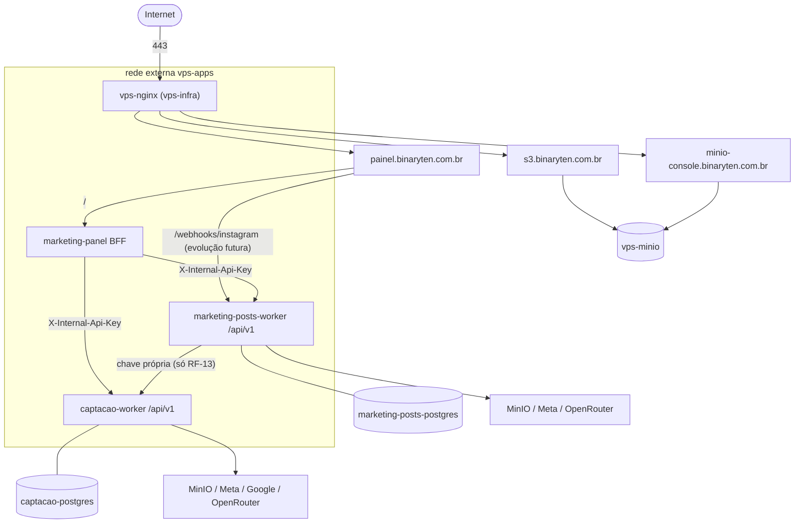

# Web Panel Marketing — Planejamento e PRD

> Painel web para **aprovar e agendar posts do Instagram** e **acompanhar leads** (CRM básico) da Binary Ten. Ponto único de operação dos dois workers.
> Base: `marketing/01` a `05`, `docs/worker-marketing-posts.md`, `docs/worker-captacao.md`, o padrão de deploy do `odd-oddities` e a infraestrutura do `vps-infra` (out/2026).
> Este documento também contém o **roadmap geral** e a **topologia da VPS** dos três serviços (§2 e §3).
> Formato compatível com `/implement-all-prd`: copiar este arquivo para `docs/prd.md` do novo repositório.

---

## 1. Objetivo e escopo

### Objetivo
Concentrar a rotina da semana em uma tela que funcione bem **no celular**:
- domingo: aprovar as pautas de carrossel e revisar os carrosséis gerados (~15–20 min);
- dias úteis: abrir a fila do dia, tocar em "Abrir WhatsApp", enviar, marcar "Enviei" (~30–45 min);
- sempre: ver em que etapa cada lead está, registrar notas e acompanhar o desempenho do conteúdo e do funil.

### Dentro do escopo
- Login de usuário único com 2FA.
- Conteúdo: pautas de carrossel, revisão/edição/aprovação de posts, criação de post do zero, calendário, desempenho.
- Leads: campanhas de descoberta, fila do dia, pipeline (kanban/lista), detalhe do lead, cadastro manual, métricas do funil.
- Configurações e status do sistema (jobs, cotas, token da Meta).
- PWA instalável na tela inicial do celular.

### Fora do escopo
- Multiusuário/perfis de acesso (estrutura preparada, não implementada).
- Caixa de entrada de WhatsApp/Instagram.
- Envio de mensagens pelo painel (só abre o app com o texto pronto).
- Reels/vídeo gravado e edição de vídeo (você optou por não gravar); tela de Reel por IA é opcional e só na Fase 3.
- Editor visual livre de design (edição é por campos dos templates).
- Funcionamento offline.

### Por que não uma ferramenta pronta
NocoDB/Appsmith/Directus sobre o Postgres resolveriam boa parte do CRM em horas. Não atendem bem o essencial do conteúdo (preview de carrossel renderizado, re-render após edição, aprovação por versão) nem a fila mobile com deep link. Ficam como plano B se o painel atrasar: o CRM pode começar no NocoDB e migrar depois.

---

## 2. Roadmap geral dos três serviços

Estimativas para desenvolvimento solo com apoio de agentes; recalibrar ao fim da Fase 1.

### Fase 0 — Pré-requisitos (manual, ~1 dia)
- [ ] VPS **Contabo Cloud VPS 4** (4 vCPU, 8 GB RAM, 100 GB SSD) — folgada para toda a stack (ver §3.3); conferir `free -h` e `df -h` antes de subir.
- [ ] Decidir **Nginx do vps-infra vs. Coolify**: o `coolify-infra` está em teste e o proxy do Coolify (Traefik/Caddy) também quer as portas 80/443. Este plano segue o modelo do odd-oddities (Nginx + Certbot). Se o Coolify virar o padrão, os composes servem, mas os vhosts e certificados passam para o Coolify.
- [ ] Instagram **@binaryten** como conta profissional; adicionar como *Instagram tester* no app Meta (o mesmo do odd-oddities ou um app novo "Binary Ten Automation"); gerar token long-lived e `INSTAGRAM_USER_ID` seguindo `odd-oddities/docs/instagram-api.md`.
- [ ] Google Cloud: projeto, billing, **Places API (New)** e **PageSpeed Insights API** ativas, chave restrita por API e IP da VPS, alerta de orçamento de US$ 1.
- [ ] OpenRouter: chave com limite de crédito.
- [ ] MinIO: buckets `marketing-posts-{dev,prod}`, `captacao-{dev,prod}`, `backups`, com access keys por projeto (`vps-infra/docs/bucket-management.md`).
- [ ] DNS: registro `A` `painel` → IP da VPS. Se for migrar o DNS para a Cloudflare (`02` §3.2), migrar **antes** para não refazer.
- [ ] Chip novo + WhatsApp Business configurado (`02` §2.1–2.2); definir a data de início da rampa de aquecimento.
- [ ] 3 repositórios no GitHub com Secrets/Variables.

### Fase 1 — Conteúdo no ar (~1,5 semana)
- worker-marketing-posts: requisitos 01 a 11 (só carrossel; sem Reels/Telegram).
- painel: RF-01 a RF-09.
- Resultado: carrosséis gerados, aprovados no painel e publicados automaticamente.
- Marco (decisão do Matheus, out/2026): **3 carrosséis publicados** + os **Stories fixos (destaques)** publicados manualmente, antes de começar a captar e divulgar. (O `01` §12 sugeria 9; você optou por 3 para começar antes — risco: perfil com menos conteúdo passa um pouco menos de credibilidade na primeira olhada do lead.)

### Fase 2 — Captação (~2 semanas)
- worker-captacao: requisitos 01 a 12 e 14.
- painel: RF-12 a RF-17.
- Marco: prospecção começa com os 3 posts + Stories no ar, seguindo a rampa do número.

### Fase 3 — Otimização (~2 semanas, contínuo)
- worker-marketing-posts: requisitos 12 a 15 (pauta a partir de lead, insights no painel, fundo de IA, comentário→DM e Reel por IA — ambos opcionais).
- worker-captacao: requisitos 13, 15 e 16.
- painel: RF-10, RF-11, RF-18 e RF-19.

### Evoluções futuras (sem data)
Prévias de site por nicho em `preview.binaryten.com.br`, formulário do site enviando leads (`04` §2.10), WhatsApp Cloud API com Coexistência (depende de CNPJ, `05`), notificações (Telegram/e-mail), migração do odd-oddities para .NET 10.

---

## 3. Topologia na VPS

### 3.1 Containers e redes



- Redes internas isoladas: `marketing-posts-internal` (worker + seu Postgres), `captacao-internal` (worker + seu Postgres), `odd-oddities-internal` (inalterado).
- Nenhum Postgres é exposto fora da rede interna do próprio serviço.
- Os workers **não têm domínio público**. O único caminho externo até um worker é `/webhooks/instagram` — e isso só existe se a RF-13 (comentário→DM, opcional) for implementada. No MVP, só o painel é público.

### 3.2 Repositórios

| Repositório | Containers | Documento |
|---|---|---|
| `binaryten-marketing-posts` | `marketing-posts-worker`, `marketing-posts-postgres` | `worker-marketing-posts.md` |
| `binaryten-captacao` | `captacao-worker`, `captacao-postgres` | `worker-captacao.md` |
| `binaryten-marketing-panel` | `marketing-panel` (API + front juntos) | este |
| `vps-infra` (existente) | `vps-nginx`, `vps-minio`, `vps-certbot` | alterações na §9 |

Todos com deploy por GitHub Actions `workflow_dispatch` → SSH → `git pull` → `.env` a partir de Secrets → `docker compose up -d --build`, igual ao odd-oddities.

### 3.3 Orçamento de memória na Contabo Cloud VPS 4 (8 GB)

Estimativa; validar com `docker stats` após o deploy.

| Serviço | Ocioso | Pico |
|---|---|---|
| odd-oddities (worker + Postgres) | ~250 MB | ~400 MB |
| vps-infra (Nginx + MinIO) | ~250 MB | ~400 MB |
| marketing-posts (worker + Postgres) | ~250 MB | ~700 MB (Chromium renderizando) |
| captacao (worker + Postgres) | ~250 MB | ~700 MB (Chromium auditando) |
| marketing-panel | ~120 MB | ~200 MB |
| Observabilidade do coolify-infra (se subir) | ~600 MB | ~1 GB |
| **Total** | **~1,7 GB** | **~3,4 GB** |

Com **8 GB de RAM** da Contabo, a stack roda folgada — mesmo com os picos simultâneos de Chromium e a observabilidade ligada sobra mais de 4 GB. Ainda assim, defina `mem_limit` em cada serviço para que um pico isolado não derrube os vizinhos. Os 4 vCPUs dão conta; a renderização e a auditoria com Chromium são as tarefas mais pesadas, mas acontecem poucas vezes por semana/dia. Disco de 100 GB é mais que suficiente (Postgres + MinIO + imagens Docker).

---

## 4. Decisões de arquitetura do painel

| Decisão | Escolha | Motivo |
|---|---|---|
| Front-end | React + Vite + TypeScript + Tailwind + shadcn/ui + TanStack Query + react-hook-form + zod + recharts + date-fns (versões atuais fixadas) | Mesma stack do site `binaryten-elevate-tech`, que o Matheus já domina |
| Back-end | **BFF em ASP.NET Core 10** (minimal API) que serve o SPA e faz proxy autenticado para os workers com **YARP** | Workers ficam privados; um só lugar de autenticação; sem CORS; mesma linguagem dos workers |
| Dados | O painel **não tem banco**: cada worker é dono dos seus dados e expõe API | Evita dois escritores no mesmo schema; deploys independentes |
| Client da API | Tipos gerados de `docs/openapi.json` de cada worker (`openapi-typescript` + `openapi-fetch`) | Contrato tipado ponta a ponta |
| Autenticação | Usuário único em variável de ambiente (hash de senha + TOTP), cookie de sessão | Simples e seguro para 1 pessoa; estrutura pronta para virar tabela de usuários |
| Mobile | Mobile-first em Fila do dia, Pautas e Revisão; PWA com manifest e ícones | O envio pelo WhatsApp acontece no celular |
| Imagens | `` com URL pré-assinada do MinIO (TTL 15 min) devolvida pelo worker | Sem trafegar bytes pelo BFF |

### Estrutura do repositório

**Sim, API (BFF) e front ficam no mesmo repositório** (`binaryten-marketing-panel`) e são publicados numa **única imagem Docker**: o `web/` é compilado para estático e servido pelo próprio BFF (.NET). Um deploy, um container, um domínio. Isso simplifica auth (sem CORS) e versionamento (front e BFF sempre casados). Os **workers** continuam em repositórios separados — só o painel junta API + front.

```
binaryten-marketing-panel/
  web/                         # SPA (compilado e embarcado no BFF em build-time)
    src/
      app/ (rotas, layout, providers)
      features/content/  (pautas, revisão, calendário, desempenho)
      features/leads/    (campanhas, fila, pipeline, detalhe, métricas)
      features/settings/
      api/ (clients gerados + hooks TanStack Query)
      components/ui/ (shadcn)
  bff/
    BinaryTen.MarketingPanel.Bff/   # auth, YARP, dashboard agregado, serve o SPA
  tests/
    BinaryTen.MarketingPanel.Bff.Tests/
  Dockerfile                   # node build → dotnet publish → aspnet runtime
  docker-compose.yml
  .github/workflows/deploy.yml
  AGENTS.md
```

---

## 5. Telas

Navegação: **Início · Conteúdo (Pautas, Revisão, Calendário, Desempenho) · Leads (Fila do dia, Pipeline, Campanhas, Métricas) · Configurações**. No celular, barra inferior com Início, Fila, Conteúdo, Leads. No MVP, "Desempenho" e a tela de Reels só aparecem quando as RFs de Fase 3 forem ao ar.

Identidade visual da marca (`01` §4): fundo Midnight, ciano como primária, laranja para alertas/ações críticas, Space Grotesk nos títulos e Plus Jakarta Sans no texto, reaproveitando as variáveis CSS do site.

### 5.1 Início (dashboard)
- Cartões de ação: "3 pautas para aprovar", "1 post aguardando revisão", "Fila de hoje: 12 + 4 follow-ups", "2 leads em conversa sem atividade há 3 dias".
- Próximas publicações (7 dias).
- Resumo da semana: posts publicados, alcance, envios, salvamentos; abordagens, respostas, taxa de resposta.
- Saúde: status dos jobs, validade do token da Meta, consumo de cotas (Places, OpenRouter). Se um worker estiver fora, o card dele mostra "indisponível" e o resto da tela continua funcionando.

### 5.2 Pautas da semana
- Lista por slot do calendário (3 carrosséis/semana) com pilar, formato, título, ângulo, gancho e CTA.
- Ações: **Aprovar**, **Editar e aprovar**, **Rejeitar** (motivo), **Gerar pauta agora**, **Novo post do zero**.
- **Gerar pauta agora** (geração sob demanda): você clica, o painel chama `POST /plans/generate`, o worker gera as ideias na hora e elas aparecem como `Proposed`. Ao aprovar uma, o worker **já dispara sozinho** a geração do carrossel (slides renderizados + legenda); quando ficar pronto, o post aparece em "Revisão" para você aprovar na hora. É o fluxo "pede → gera tudo → aprovo" que você descreveu.
- **Novo post do zero** (`POST /posts`): abre um formulário onde você define o **texto/tema sugerido**, a **quantidade de slides**, **dicas de imagem** para a IA usar como base (ex.: "fundo com circuito azul", "mockup de celular") e, se quiser, já escreve parte da legenda. O worker gera o rascunho a partir disso e para em "Revisão". Serve para quando você tem uma ideia específica e não quer esperar o planejamento semanal.
- Reservas sugeridas aparecem recolhidas para substituir uma rejeitada.

### 5.3 Revisão de post
- O que a edição faz: **cada alteração sua (editar slide, legenda, pedir ajuste à IA) aciona o worker para gerar uma nova versão** com base no que você mudou — a imagem do slide é re-renderizada pelo template. Você não edita a imagem final à mão; edita os campos e o worker regenera. Cada versão fica registrada e a aprovação é sempre da versão que está na tela.
- **Carrossel**: preview em carrossel deslizável no tamanho real 4:5 (simulando o feed), miniaturas, indicador de versão.
- Editor por slide com os campos do template (título, corpo, destaque, ícone), contador de palavras/caracteres com os limites da validação; botão **Re-renderizar** (nova versão, preview atualiza ao terminar).
- Legenda: editor com contador de 2.200, aviso se a 1ª linha passar de 125 caracteres, hashtags como chips (máx. 5).
- **Pedir ajuste à IA** com instrução livre ("deixa mais curto", "troca o gancho").
- **Aprovar e agendar**: data/hora sugerida = próximo slot; campo para alterar; **Publicar agora** com confirmação.
- Histórico de versões (quem mudou, quando, o quê).
- Aprovar envia a `version` exibida; se o worker responder conflito (versão mudou), a tela recarrega e avisa.

### 5.4 Calendário editorial
- Visões semana e mês; cartões coloridos por estado (rascunho, aguardando aprovação, agendado, publicado, falhou) e por pilar.
- Arrastar para outro dia reagenda (com confirmação); clique abre a revisão.
- Posts publicados manualmente (sincronizados) aparecem como publicados.

### 5.5 Reels por IA (Fase 3, opcional — só se a RF-15 do worker for ligada)
- Como você optou por não gravar vídeo, no MVP **não há tela de Reels**. Esta tela só existe se você ligar a geração de Reel curto por IA.
- Nela: preview do vídeo gerado (6–10 s, 9:16), legenda, aprovar/rejeitar, agendar. Sem gravação nem upload (o vídeo vem da IA).
- Custo aparece antes de gerar (teto mensal configurável).

### 5.6 Desempenho de conteúdo (Fase 3)
- Tabela de posts com alcance, visualizações, envios/alcance, salvamentos/alcance, comentários, visitas ao perfil; ordenável.
- Gráfico por pilar e ranking de ganchos.
- Link para o post no Instagram.

### 5.7 Campanhas de descoberta
- Formulário: nicho (lista), cidade (ex.: Santa Luzia, Lagoa Santa), bairro/raio opcional, frase de proximidade (`local_angle`), máximo de resultados; **estimativa de consumo de cota** antes de confirmar.
- Lista de campanhas com progresso e estatísticas (encontrados, novos, duplicados, descartados por motivo, A/B).

### 5.8 Fila do dia (mobile-first, a tela mais usada)
- Cabeçalho: "Hoje: 7 de 15 enviados", barra de progresso, alerta se a rampa ainda está em aquecimento.
- Cartão por lead: nome, nicho, cidade, nota e avaliações, score, fato usado na mensagem, miniatura do screenshot do site (toque amplia), mensagem editável.
- Botões grandes: **Abrir WhatsApp** (abre o `wa.me` com o texto), **Copiar mensagem**, **Abrir Instagram** (quando o canal for DM), e depois **Enviei**, **Pular hoje**, **Não é ICP**, **Número inválido**.
- **Como o painel sabe que você enviou**: ele não lê o WhatsApp. Ao tocar em "Abrir WhatsApp" você vai para o app, envia e volta; ao voltar, o painel detecta o retorno (`visibilitychange`) e pergunta "Enviou?". Você confirma em **Enviei** (chama `POST /queue/{id}/sent` → lead vira `Abordado`, agenda o follow-up) ou **Pular hoje**. Tudo com um toque.
- Seção separada para follow-ups do dia.
- Dica exibida no primeiro uso: no Android, definir o **WhatsApp Business** como app padrão para links `wa.me` (com dois WhatsApps instalados o sistema pergunta qual abrir).

### 5.9 Pipeline
- **Kanban** com colunas Qualificado · Abordado · Em conversa · Reunião · Orçamento · Fechado · Perdido (arrastar = mudar estado, com motivo quando for Perdido).
- **Lista** com filtros (estado, score, nicho, cidade, origem, texto) e ordenação; exportação CSV.
- Indicador de "parado há X dias".

### 5.10 Detalhe do lead
- Dados do negócio (editáveis: Instagram, e-mail, responsável, canal preferido, valor estimado/fechado).
- Diagnóstico: fatos com ícone de problema (laranja) e de ok (ciano), screenshots mobile/desktop, notas do PageSpeed, botão **Refazer diagnóstico**.
- Mensagens: 1ª abordagem e follow-ups, editáveis, com o mesmo botão de abrir WhatsApp.
- Linha do tempo de atividades; campo de nota rápida.
- Ações: mudar estado, **Opt-out** (confirmação explícita), **Exportar dados**, **Excluir**, **Usar como pauta** (Fase 3).
- Links: Google Maps, site, Instagram.

### 5.11 Cadastro manual
- Formulário curto (nome do negócio, nicho, telefone, Instagram, cidade, origem: indicação/evento/rede/manual, observação), com aviso se já existir ou estiver suprimido.

### 5.12 Métricas do funil
- Funil do período (abordados → responderam → conversa → reunião → orçamento → fechado) com taxas e as referências de `03` §10.
- Quebras por nicho, origem e variante de mensagem; evolução semanal.
- Alertas de leitura: taxa de resposta < 10% ("revisar mensagem ou nicho"), fechamento < 20% ("revisar oferta/prova social").

### 5.13 Configurações (Fase 3)
- Conteúdo: calendário (dias, horários, formatos), pesos dos pilares, banco de ganchos, gatilhos de comentário.
- Captação: limites da fila, data de início da rampa, regras de ICP, nichos, templates de mensagem e variantes.
- Integrações: status do token da Meta (validade), cotas (Places, OpenRouter).

---

## 6. BFF — endpoints próprios

| Método | Rota | Uso |
|---|---|---|
| POST | `/api/auth/login` | `{ username, password, totp }` → cookie de sessão |
| POST | `/api/auth/logout` | Encerra a sessão |
| GET | `/api/auth/me` | Sessão atual |
| GET | `/api/dashboard` | Agrega `status` e resumos dos dois workers em paralelo, com timeout de 3 s por worker e resposta parcial |
| GET | `/health` | Health do BFF (para o Docker) |
| * | `/api/posts/{**}` | YARP → `marketing-posts-worker:8080/api/v1/{**}` |
| * | `/api/leads/{**}` | YARP → `captacao-worker:8080/api/v1/{**}` |

Transformações do YARP: remover `Cookie` e `Authorization` da requisição repassada, adicionar `X-Internal-Api-Key`, repassar `X-Request-Id` para correlação de logs. Limite de corpo de 1 MB nas rotas (não há upload de arquivo grande no MVP — o Reel por IA, se ligado, é gerado no worker, não enviado pelo painel).

---

## 7. Segurança

O painel é o único serviço novo exposto à internet e dá acesso a dados de leads e à publicação na conta da empresa.

- **Login**: usuário e hash de senha (`PasswordHasher` do ASP.NET Core) em variáveis de ambiente; comando utilitário `dotnet BinaryTen.MarketingPanel.Bff.dll hash-password` para gerar o hash. **TOTP obrigatório** (segredo em variável de ambiente, QR code gerado uma vez pelo mesmo utilitário).
- **Rate limit** no login: 5 tentativas/15 min por IP + atraso progressivo; logs de falha sem a senha.
- **Cookie** `__Host-panel`: `Secure`, `HttpOnly`, `SameSite=Strict`, expiração deslizante de 12 h e absoluta de 7 dias.
- **Data Protection keys** persistidas em volume Docker (`/keys`); sem isso, todo deploy desloga e invalida cookies.
- **CSRF**: `SameSite=Strict` + exigir header `X-Panel-Request: 1` e conferir `Origin` em métodos que alteram estado.
- **Headers**: `Content-Security-Policy` (`default-src 'self'; img-src 'self' https://s3.binaryten.com.br data:; media-src 'self' https://s3.binaryten.com.br; connect-src 'self'; frame-ancestors 'none'`), HSTS, `X-Content-Type-Options`, `Referrer-Policy: no-referrer`, `X-Robots-Tag: noindex, nofollow`.
- Todas as rotas `/api/**` exigem sessão, exceto login.
- Workers só acessíveis pela rede Docker; chaves internas diferentes por consumidor.
- Opcional, se o DNS for para a Cloudflare: **Cloudflare Access** (gratuito para poucos usuários) na frente do painel como segunda barreira, com exceção de `/webhooks/instagram`.
- Auditoria: o BFF registra em log cada ação que altera estado (rota, alvo, resultado), sem payload sensível.

---

## 8. Configuração

```env
PANEL_ADMIN_USERNAME=matheus
PANEL_ADMIN_PASSWORD_HASH=
PANEL_TOTP_SECRET=
PANEL_PUBLIC_ORIGIN=https://painel.binaryten.com.br

MARKETING_POSTS_API_BASE_URL=http://marketing-posts-worker:8080/api/v1
MARKETING_POSTS_API_KEY=
CAPTACAO_API_BASE_URL=http://captacao-worker:8080/api/v1
CAPTACAO_API_KEY=

STORAGE_PUBLIC_ORIGIN=https://s3.binaryten.com.br   # usado na CSP
```

---

## 9. Deploy

### 9.1 Imagem
- `Dockerfile` multi-stage: `node:22-alpine` (build do `web/`) → `mcr.microsoft.com/dotnet/sdk:10.0` (publish do BFF) → `mcr.microsoft.com/dotnet/aspnet:10.0` com o SPA em `wwwroot`, usuário não root, `curl` para healthcheck.
- Fallback do SPA: rotas desconhecidas fora de `/api` devolvem `index.html`; assets com hash recebem cache longo, `index.html` sem cache.

### 9.2 Compose
- Serviço `marketing-panel` na rede externa `vps-apps`, volume `marketing-panel-keys:/keys`, `mem_limit: 256m`, healthcheck em `/health`.

### 9.3 Alterações no `vps-infra` (seguindo `docs/add-new-service.md`)
1. `PANEL_DOMAIN=painel.binaryten.com.br` no `.env` e no `environment` do serviço `nginx`.
2. Rede externa `vps-apps` no serviço `nginx`.
3. Template `nginx/templates/panel.conf.template`:
   ```nginx
   server {
       listen 443 ssl;
       http2 on;
       server_name ${PANEL_DOMAIN};
       # ssl_certificate / headers TLS iguais ao exemplo de add-new-service.md

       client_max_body_size 4m;

       location /webhooks/instagram {          # só se a RF-13 (comentário→DM) for implementada
           client_max_body_size 1m;
           proxy_pass http://marketing-posts-worker:8080;
           proxy_set_header Host $host;
           proxy_set_header X-Forwarded-For $proxy_add_x_forwarded_for;
           proxy_set_header X-Forwarded-Proto https;
       }

       location / {
           proxy_pass http://marketing-panel:8080;
           proxy_set_header Host $host;
           proxy_set_header X-Real-IP $remote_addr;
           proxy_set_header X-Forwarded-For $proxy_add_x_forwarded_for;
           proxy_set_header X-Forwarded-Proto https;
           proxy_http_version 1.1;
           proxy_set_header Connection "";
       }
   }
   ```
   (mais o bloco `listen 80` com ACME e redirect, igual ao exemplo).
4. Certificado: `create-dummy-certs.sh painel.binaryten.com.br` → `docker compose up -d nginx` → `init-cert.sh painel.binaryten.com.br` → `nginx -s reload`.
5. O BFF precisa confiar nos headers do proxy: `ForwardedHeaders` configurado para a rede `vps-apps` (para o rate limit usar o IP real e o cookie `Secure` funcionar).

Ordem de subida: workers primeiro (o Nginx falha ao iniciar se um `proxy_pass` apontar para um nome que não resolve — usar `resolver 127.0.0.11` + variável no `proxy_pass` evita isso).

---

## 10. Testes

- BFF: xUnit + `WebApplicationFactory` cobrindo login (senha errada, TOTP errado, rate limit), cookie, CSRF, proxy (injeção da chave, remoção do cookie), dashboard parcial com worker fora.
- Front: Vitest + Testing Library para componentes críticos (editor de slide com limites, cartão da fila, montagem do deep link não é feita no front — só exibida); MSW para simular as APIs.
- E2E (opcional, Fase 3): Playwright cobrindo login → aprovar pauta → aprovar post; e fila do dia em viewport mobile.
- `npm run build`, `npm run lint`, `dotnet build`, `dotnet test` como gates do `/implement-all-prd`.

---

## 11. Riscos

| Risco | Mitigação |
|---|---|
| Painel exposto com dados de leads e poder de publicar | 2FA, rate limit, cookie estrito, CSP, opcional Cloudflare Access |
| Contrato dos workers muda e quebra o painel | Tipos gerados do OpenAPI; versão `/api/v1`; build do painel falha se o contrato mudar |
| Marco de só 3 posts pode reduzir credibilidade na primeira olhada do lead | Priorizar os 3 melhores formatos (antes/depois, educação, oferta); completar com Stories fixos; subir para 6–9 posts conforme a captação andar |
| Um worker fora derruba o painel | Dashboard com resposta parcial; cada tela trata indisponibilidade do seu worker |
| Deslogar a cada deploy | Data Protection keys em volume |

---

## 12. Requisitos funcionais

Fases (ver §2): **Fase 1** RF-01 a RF-09 · **Fase 2** RF-12 a RF-17 · **Fase 3** RF-10, RF-11, RF-18, RF-19.
Dependências de outros repositórios aparecem em "Pré-requisitos externos" e não bloqueiam a ordem interna.

## [ ] RF-01: Estrutura do repositório e build único

- `web/` (Vite + React + TS + Tailwind + shadcn/ui com o tema da marca) e `bff/` (.NET 10 minimal API servindo o SPA).
- `Dockerfile` multi-stage, `docker-compose.yml`, `.env.example`, `AGENTS.md` com comandos de build/test/lint.
- Critérios de aceite: `npm run build`, `npm run lint`, `dotnet build`, `dotnet test` passam; a imagem sobe e serve o SPA em `/` e `/health` responde 200; rota desconhecida do SPA devolve `index.html`.

**Dependências:** nenhuma

## [ ] RF-02: Deploy e publicação em painel.binaryten.com.br

- Workflow `deploy.yml` (workflow_dispatch) no padrão do odd-oddities.
- Alterações no `vps-infra` da §9.3 documentadas no README do painel (vhost, rede, certificado), headers de segurança da §7, `ForwardedHeaders`.
- Critérios de aceite: `curl -I https://painel.binaryten.com.br` retorna 200 com HSTS, CSP e `X-Robots-Tag`; certificado válido.

**Dependências:** RF-01

## [ ] RF-03: Autenticação com 2FA

- Login com usuário/hash/TOTP de variáveis de ambiente, utilitário `hash-password` e geração de QR do TOTP.
- Cookie `__Host-panel`, expiração deslizante e absoluta, logout, `/api/auth/me`.
- Rate limit no login, Data Protection keys em volume, proteção CSRF (header + Origin).
- Tela de login responsiva; rotas protegidas no SPA redirecionam para o login.
- Critérios de aceite: testes para senha errada, TOTP errado, bloqueio por rate limit, requisição mutável sem header → 403, sessão sobrevive a restart do container.

**Dependências:** RF-01

## [ ] RF-04: Proxy para os workers e clients tipados

- YARP com as rotas e transformações da §6; limites de corpo por rota.
- Geração de tipos TypeScript a partir do `docs/openapi.json` de cada worker (script `npm run gen:api`); hooks TanStack Query por recurso.
- Tratamento padrão de erros (ProblemDetails → toast com mensagem legível; 409 de versão → recarregar).
- Critérios de aceite: teste comprovando que a chave interna é injetada e o cookie removido; sem sessão o proxy retorna 401 sem chamar o worker.

**Dependências:** RF-03 · Pré-requisitos externos: API interna dos dois workers (worker-marketing-posts requisito 05, worker-captacao requisito 04)

## [ ] RF-05: Layout, navegação e PWA

- Layout com menu lateral (desktop) e barra inferior (mobile), tema escuro da marca, estados de carregamento/vazio/erro padronizados.
- Manifest PWA com ícones da logo, `display: standalone`, tema `#080B12`.
- Acessibilidade: navegação por teclado, foco visível, contraste AA, `aria-label` nos botões de ícone, alvos de toque ≥ 44 px.
- Critérios de aceite: Lighthouse mobile ≥ 90 em acessibilidade; "Adicionar à tela inicial" funciona no Android.

**Dependências:** RF-03

## [ ] RF-06: Dashboard

- Tela da §5.1 usando `/api/dashboard` com resposta parcial.
- Na Fase 1 mostra só os cards de conteúdo e saúde do worker-marketing-posts; cards de leads aparecem quando o worker-captacao responder.
- Critérios de aceite: com um worker parado, a tela carrega e indica o serviço indisponível.

**Dependências:** RF-04, RF-05

## [ ] RF-07: Pautas da semana e geração sob demanda

- Tela da §5.2: aprovar, editar e aprovar, rejeitar com motivo, **gerar pauta agora** (`POST /plans/generate`) e **novo post do zero** (`POST /posts` com texto sugerido, nº de slides, dicas de imagem e legenda inicial).
- Critérios de aceite: aprovar uma pauta (ou criar do zero) dispara a geração do rascunho e o post aparece em "Revisão" quando ficar pronto (polling de 10 s enquanto houver rascunho em geração); "gerar pauta agora" produz ideias `Proposed` na hora.

**Dependências:** RF-05 · Pré-requisitos externos: worker-marketing-posts requisitos 06 e 09

## [ ] RF-08: Revisão, edição e aprovação de post

- Tela da §5.3: preview 4:5, editor por slide com limites, **re-render** (cada edição aciona o worker a gerar nova versão), legenda com contadores, hashtags, pedir ajuste à IA, aprovar com versão, agendar, publicar agora (confirmação), descartar, histórico.
- Critérios de aceite: editar um slide gera nova versão e novo preview; aprovar com versão desatualizada mostra aviso e recarrega; não existe botão que publique sem aprovação da versão atual.

**Dependências:** RF-07 · Pré-requisitos externos: worker-marketing-posts requisitos 08 e 09

## [ ] RF-09: Calendário editorial

- Tela da §5.4: semana/mês, cores por estado e pilar, arrastar para reagendar com confirmação, abrir revisão.
- Critérios de aceite: reagendar pelo calendário altera `scheduledAt` no worker; posts publicados exibem link do Instagram.

**Dependências:** RF-08 · Pré-requisitos externos: worker-marketing-posts requisito 10

## [ ] RF-10: Reel por IA (Fase 3, opcional)

- Tela da §5.5: preview do vídeo gerado por IA, legenda, aprovar/rejeitar, agendar, custo exibido antes de gerar. **Só aparece se a RF-15 do worker estiver ligada** (você optou por não gravar vídeo).
- Critérios de aceite: com a feature ligada, um Reel gerado é previsto, aprovado e agendado pelo painel; com ela desligada, a tela não aparece.

**Dependências:** RF-08 · Pré-requisitos externos: worker-marketing-posts requisito 15

## [ ] RF-11: Desempenho de conteúdo

- Tela da §5.6 com tabela ordenável, gráficos por pilar e ranking de ganchos.
- Critérios de aceite: métricas batem com as retornadas pelo worker; posts sincronizados aparecem.

**Dependências:** RF-06 · Pré-requisitos externos: worker-marketing-posts requisito 11

## [ ] RF-12: Campanhas de descoberta

- Tela da §5.7 com estimativa de consumo de cota (usando `/usage`) e confirmação; lista com progresso.
- Critérios de aceite: criar campanha mostra progresso até concluir; bloqueio de cota exibido com mensagem clara.

**Dependências:** RF-05 · Pré-requisitos externos: worker-captacao requisitos 05 e 07

## [ ] RF-13: Fila do dia

- Tela da §5.8 mobile-first: cartões, edição da mensagem, Abrir WhatsApp/Instagram, Copiar, Enviei, Pular, Não é ICP, Número inválido, seção de follow-ups, confirmação ao retornar ao app (`visibilitychange`).
- Critérios de aceite: em viewport 390 px todos os botões são acessíveis com o polegar; "Enviei" atualiza o progresso sem recarregar; link abre o WhatsApp com o texto exibido no cartão.

**Dependências:** RF-05 · Pré-requisitos externos: worker-captacao requisitos 10 e 11

## [ ] RF-14: Pipeline (kanban e lista)

- Tela da §5.9: kanban com arrastar entre estados (motivo obrigatório para Perdido), lista com filtros, ordenação e CSV, indicador de leads parados.
- Critérios de aceite: transição inválida retornada pelo worker desfaz o movimento e explica o motivo.

**Dependências:** RF-05 · Pré-requisitos externos: worker-captacao requisito 04

## [ ] RF-15: Detalhe do lead

- Tela da §5.10: dados editáveis, diagnóstico com screenshots, refazer diagnóstico, mensagens, linha do tempo, notas, mudar estado, opt-out com confirmação, exportar, excluir.
- Critérios de aceite: opt-out exige confirmação explícita e remove o lead da fila imediatamente; exportação baixa JSON com todos os dados do lead.

**Dependências:** RF-14 · Pré-requisitos externos: worker-captacao requisitos 08, 10 e 14

## [ ] RF-16: Cadastro manual de lead

- Formulário da §5.11 com validação (zod), aviso de duplicado/suprimido.
- Critérios de aceite: lead manual aparece no pipeline com a origem informada.

**Dependências:** RF-14

## [ ] RF-17: Métricas do funil

- Tela da §5.12 com funil, taxas, quebras e alertas de leitura.
- Critérios de aceite: números batem com `/metrics/funnel`; período selecionável.

**Dependências:** RF-06 · Pré-requisitos externos: worker-captacao requisito 12

## [ ] RF-18: Configurações

- Tela da §5.13 para conteúdo, captação e integrações, com validação dos campos e confirmação ao salvar.
- Critérios de aceite: alterar o horário de um slot muda o agendamento sugerido de novos posts; alterar o limite da fila vale na próxima montagem.

**Dependências:** RF-06

## [ ] RF-19: Lead vira pauta

- Ação "Usar como pauta" no detalhe do lead: escolhe formato, marca se há autorização do negócio, envia o contexto (nicho, fatos do diagnóstico, screenshots) para o worker-marketing-posts e mostra a pauta criada.
- Critérios de aceite: pauta criada com `lead_ref`; sem autorização, a tela avisa que o nome será anonimizado.

**Dependências:** RF-07, RF-15 · Pré-requisitos externos: worker-marketing-posts requisito 12
