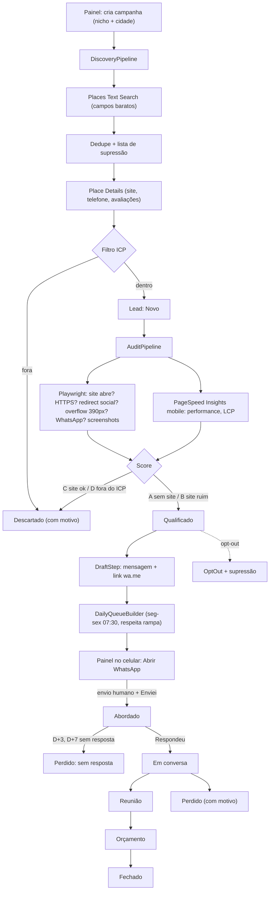
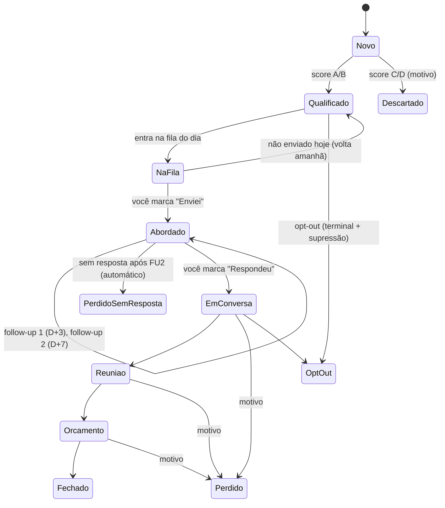

# Worker Captação — Planejamento e PRD

> Worker .NET que descobre, qualifica, diagnostica e prepara a abordagem de leads (pequenos negócios locais) e mantém o CRM básico da Binary Ten. **O envio da mensagem é sempre humano.**
> Base: `marketing/03-captacao-de-leads.md` (ICP, pipeline, mensagens, LGPD, funil), `marketing/02-whatsapp-e-email.md` §2.4 (semi-automação via `wa.me`) e a arquitetura do `C:\binaryten-git\odd-oddities` (out/2026).
> Documentos irmãos: `docs/worker-marketing-posts.md` e `docs/web-panel-marketing.md` (roadmap geral e topologia da VPS).
> Formato compatível com `/implement-all-prd`: copiar este arquivo para `docs/prd.md` do novo repositório.

---

## 1. Objetivo e escopo

### Objetivo
Automatizar 90% do trabalho de prospecção (pesquisa, filtro, diagnóstico do site, rascunho da mensagem, lembrete de follow-up) e deixar para o Matheus só o que não deve ser automatizado: **tocar no link, revisar em 5 segundos e enviar** pelo WhatsApp Business do celular.

Meta operacional (`03` §11): 10–20 abordagens novas por dia útil, máximo 2 follow-ups, ~30–45 min/dia.

### Dentro do escopo
- Campanhas de descoberta por nicho + bairro/cidade via **Google Places API (New)**.
- Filtro de ICP, deduplicação e lista de supressão.
- Diagnóstico automático do site (Playwright + PageSpeed Insights API) com screenshots.
- Score A/B/C/D com motivos rastreáveis.
- Rascunho de mensagens personalizadas (LLM + templates de `03` §6) e link `wa.me` pré-preenchido.
- Fila diária com rampa de aquecimento do número novo e follow-ups D+3/D+7.
- CRM: estados, linha do tempo, notas, valores, motivo de perda, métricas do funil.
- Entrada de leads de outras origens (manual, comentário no Instagram, indicação, formulário do site no futuro).
- LGPD: origem do dado, opt-out permanente, supressão, retenção e eliminação.
- API interna consumida pelo painel e pelo worker-marketing-posts.

### Fora do escopo
- **Envio automático** de mensagens em qualquer canal (WhatsApp, DM, e-mail). Decisão de `02` §2.3 e `03` §7: risco de banimento/reputação maior que o ganho.
- APIs não oficiais de WhatsApp (Evolution/Baileys/WAHA/Z-API).
- Scraping do Google Maps.
- Leitura automática de respostas do WhatsApp (o status "respondeu" é marcado à mão). Fase futura: WhatsApp Cloud API com Coexistência, quando houver CNPJ.
- E-mail frio pela Resend (proibido pela política de uso da Resend).
- Geração automática das prévias de site por nicho (`03` §5) — fica como evolução; o lead já tem campo `preview_url`.

---

## 2. Decisões de arquitetura

| Decisão | Escolha | Motivo |
|---|---|---|
| Base de código | Copiar a estrutura do odd-oddities (hexagonal, pipeline/steps, OpenRouter com fallback, Serilog, migrations automáticas, deploy) | Padrão já validado em produção |
| Runtime | **.NET 10 (LTS)** | .NET 8 sai de suporte em 10/11/2026 |
| Fonte de dados | Google Places API (New) — Text Search + Place Details com **FieldMask** | Oficial, cota gratuita mensal, sem violar termos com scraping |
| Diagnóstico | Microsoft.Playwright (Chromium) + PageSpeed Insights API v5 | PSI é grátis; Playwright detecta WhatsApp, overflow mobile, redirecionamento para Instagram/Linktree |
| Telefone | `libphonenumber-csharp` (E.164, tipo fixo/móvel) | Link `wa.me` só faz sentido para celular |
| Mensagens | Template determinístico + LLM só para a frase personalizada, com validação | Evita "fato inventado" e garante opt-out e ausência de link |
| Banco | Postgres 16 dedicado (é o CRM) | Isolamento; backup próprio |
| Fila diária | Calculada pelo worker, consumida no painel (mobile-first) | O painel substitui a planilha de prospecção de `03` §4.2 |
| Integração com posts | API interna recebe leads do comentário→DM; painel usa dados do lead para pautas "Refazendo o site de…" | Um trabalho, vários usos (`04` §2.4) |

### Visão geral



---

## 3. ICP e regras de qualificação

Fonte: `03` §2. Todos os limites são configuráveis em `settings`.

| Regra | Padrão |
|---|---|
| `businessStatus` | `OPERATIONAL` |
| Avaliações | `userRatingCount ≥ 20` |
| Nota | `rating ≥ 4,3` |
| Nichos | clínicas, odontologia, estética, advocacia, contabilidade, arquitetura, psicologia, fisioterapia, veterinária, pequenas indústrias, fotógrafos (mapeados para `includedType`/termos de busca) |
| Região inicial | **Santa Luzia/MG** (cidade do Matheus, argumento "sou daqui"); depois **Lagoa Santa/MG** e demais cidades vizinhas |
| Exclusões | franquias (lista de marcas + heurística por nome repetido em várias campanhas), já existente no CRM, presente na lista de supressão |

### Onde você define os termos de busca (nichos e cidades)

Você não "programa" a busca: cadastra **nichos** e cria **campanhas** no painel. A busca do Google Places é por texto livre, então o worker monta a consulta a partir de `search_terms` do nicho + o local da campanha.

- **`Niche`** (setor-alvo): `search_terms` (ex.: `["clínica odontológica", "dentista"]`), `google_types` (filtro de tipo), e `message_context` (o gancho de venda daquele setor). Cadastre os nichos que quer atacar.
- **`DiscoveryCampaign`** (nicho + cidade): combina um nicho com `location_text` ("Santa Luzia, MG") e, opcional, `location_bias` (ponto central + raio, para focar num bairro/região). Campo novo **`local_angle`**: a frase de proximidade usada na mensagem daquele local (ex.: Santa Luzia → "sou aqui de Santa Luzia também"; Lagoa Santa → "atendo bastante gente aí da região").

Seu plano se traduz assim:

| Fase | Campanhas | Observação |
|---|---|---|
| 1 | Santa Luzia + nichos escolhidos (ex.: odontologia, estética, advocacia, veterinária) | `local_angle` reforça "sou daqui"; prioridade por ser sua cidade |
| 2 | Lagoa Santa + nichos de maior ticket (ex.: clínicas, arquitetura, estética premium) | cidade mais rica; `local_angle` de região |
| 3 | demais cidades vizinhas / BH, conforme a taxa de resposta | expandir só quando as duas primeiras saturarem |

O `message_context` (por nicho) e o `local_angle` (por campanha) entram no prompt da mensagem — é assim que a abordagem fica personalizada por setor e por cidade.

### Score (como o Playwright e o PageSpeed decidem se é lead quente)

Dois diagnósticos automáticos do site do lead, usados para classificar:

- **Playwright** abre o site num navegador real e verifica o **estrutural**: abre? tem HTTPS? redireciona para Instagram/Linktree (= não tem site de verdade)? quebra no celular? tem botão de WhatsApp? — e tira os prints. É a maior parte do diagnóstico.
- **PageSpeed Insights** dá a **nota de velocidade** no celular (performance e tempo de carregamento). É opcional: se falhar, o score usa só o Playwright.

Lead sem site ou com site ruim/lento é quente (A/B); site bom é frio (C).

| Score | Regra | Destino |
|---|---|---|
| **A** | Sem site: `websiteUri` vazio **ou** aponta para Instagram/Facebook/Linktree/`wa.me`/agregador; ICP atendido | `Qualificado` (prioridade máxima; candidato a prévia) |
| **B** | Tem site com ≥ 2 problemas graves: não abre/timeout, sem HTTPS, sem viewport ou overflow horizontal em 390 px, PSI mobile < 50 ou LCP > 4 s, sem link de WhatsApp nem `tel:` clicável, © ≤ 2021 | `Qualificado` |
| **C** | Site razoável (< 2 problemas graves) | `Descartado` motivo `site_ok` (pode ser reativado) |
| **D** | Fora do ICP | `Descartado` com motivo específico |

Cada problema detectado vira um **fato** (`LeadFact`: código, texto legível, valor medido, fonte, data). A mensagem só pode citar fatos dessa lista.

---

## 4. Modelo de domínio

### 4.1 Estados do lead



Leads inbound (comentário no Instagram, indicação, cadastro manual com conversa já iniciada) entram direto em `EmConversa`. A transição `Abordado → PerdidoSemResposta` é feita pelo próprio worker (você não precisa mover à mão); você só age quando o lead responde.

### 4.2 Entidades (PostgreSQL, código em inglês)

| Entidade | Campos principais |
|---|---|
| `Niche` | id, key, name, search_terms (text[]), google_types (text[]), message_context (ex.: "agendamento de pacientes"), active |
| `DiscoveryCampaign` | id, niche_id, location_text ("Santa Luzia, MG"), local_angle (frase de proximidade usada na mensagem), location_bias (lat/lng/raio, opcional), recurring (bool), max_results, status (Pending/Running/Completed/Failed), stats (jsonb: encontrados, novos, duplicados, descartados por motivo, qualificados A/B), created_at, finished_at |
| `Lead` | id, place_id (único, nulo para manual), name, niche_id, address, neighborhood, city, phone_e164, phone_type (Mobile/Landline/Unknown), website, instagram, email, google_maps_url, rating, reviews_count, business_status, score, status, source (GooglePlaces/Manual/InstagramComment/Referral/SiteForm), source_detail, campaign_id?, preferred_channel (WhatsApp/InstagramDM/Email/Phone), estimated_value, closed_value, lost_reason, preview_url, owner_name?, google_data_fetched_at, first_contact_at, last_contact_at, next_follow_up_at, follow_up_count, opt_out_at, retention_until, created_at, updated_at |
| `LeadFact` | id, lead_id, code (`no_website`, `social_redirect`, `no_https`, `slow_mobile`, `no_whatsapp`, `not_responsive`, `old_copyright`, `reviews_highlight`…), text, value, source, created_at |
| `SiteAudit` | id, lead_id, requested_url, final_url, reachable, http_status, https, redirects_to_social, load_ms, psi_performance, psi_lcp_ms, has_viewport, horizontal_overflow, has_whatsapp_link, has_tel_link, title, meta_description, copyright_year, screenshot_mobile_key, screenshot_desktop_key, raw (jsonb), error, audited_at |
| `OutreachMessage` | id, lead_id, kind (First/FollowUp1/FollowUp2), channel, template_key, template_variant (A/B), body, fact_codes (text[]), deep_link (wa.me / perfil IG / mailto), model_used?, status (Draft/Queued/Sent/Skipped/Cancelled), queued_for (date), sent_at, created_at |
| `LeadActivity` | id, lead_id, type (Created, StatusChanged, MessageSent, ReplyMarked, NoteAdded, MeetingScheduled, ProposalSent, ValueChanged, OptOut, DataExported, DataErased…), from_status, to_status, payload (jsonb), created_at — base das métricas |
| `MessageTemplate` | id, key (`whatsapp_no_site`, `whatsapp_bad_site`, `ig_dm_linktree`, `followup_1`, `followup_2`, `email_b2b`), channel, variant, body (com placeholders), active |
| `SuppressionEntry` | id, kind (Phone/PlaceId/Email/Instagram), value_hash (SHA-256 do valor normalizado + pepper), reason, created_at |
| `ApiUsage` | provider, sku, period (yyyy-MM), count, soft_limit, hard_limit |
| `DailyQueueRun` | date, target_new, target_follow_ups, built_at, stats |
| `GenerationAttempt`, `SystemSetting` | como no odd-oddities |

Seeds: nichos de `03` §2, templates de `03` §6 (variante A), lista inicial de franquias, configurações padrão.

---

## 5. Integrações externas e cotas

### 5.1 Google Places API (New)
- `POST https://places.googleapis.com/v1/places:searchText` com `textQuery` ("clínica odontológica em Santa Luzia, MG"), `languageCode=pt-BR`, `regionCode=BR`, `pageSize=20`, paginação por `nextPageToken` (até 60 resultados por consulta).
- **FieldMask mínima no Text Search** (sem campos de SKU alto): `places.id,places.displayName,places.formattedAddress,places.types,places.businessStatus,places.googleMapsUri,nextPageToken`.
- Filtro barato (tipo, status operacional, não duplicado, não suprimido, não franquia) **antes** de qualquer Details.
- `GET https://places.googleapis.com/v1/places/{id}` com FieldMask `rating,userRatingCount,websiteUri,nationalPhoneNumber,internationalPhoneNumber` só para candidatos.

#### Até onde é grátis (confirmado out/2026)
O Google substituiu o antigo crédito de US$ 200 por **cotas grátis por SKU, por mês** (nível selecionado):

| Categoria de SKU | Chamadas grátis/mês |
|---|---|
| Essentials | 10.000 |
| Pro | 5.000 |
| Enterprise | 1.000 |

- A cobrança é sempre pelo **SKU mais caro** da chamada. Por isso a estratégia de 2 passos: **Text Search** só com campos Essentials (busca ampla, barata) e **Place Details** só nos candidatos aprovados no filtro (é onde está o custo real, por trazer `websiteUri`/telefone/avaliações).
- O gargalo da cota é o **Details**: 1 por candidato. **A validar antes da RF-06**: em qual SKU o campo `websiteUri` cai hoje — se Pro, o teto grátis é ~5.000 Details/mês; se Enterprise, ~1.000/mês. Isso muda o volume em 5x. Registrar o valor medido em `settings`.
- Proteções: `ApiUsage` com **hard limit em 90% da cota grátis** do SKU usado (o worker se recusa a chamar além disso), alerta em 70%, orçamento de US$ 1 com alerta no Google Cloud, chave de API restrita à Places API e ao IP da VPS.

#### Quantos leads por mês? E os "1.500"?
- Dentro do grátis, dá para gerar na ordem de **centenas a alguns milhares de leads qualificados/mês**, conforme o SKU do `websiteUri` (acima) e a taxa de ICP da busca (nem todo negócio buscado passa no filtro de avaliações/nota).
- **1.500 leads/mês é tecnicamente possível** (provável se `websiteUri` for Pro; apertado se for Enterprise, mas Santa Luzia + Lagoa Santa são cidades pequenas e você esgota os negócios do nicho antes de bater o teto).
- **Sua capacidade de envio é ~50/dia** (≈ **1.000–1.100 abordagens/mês** em dias úteis), após a rampa de aquecimento do número. Então gerar ~1.500 leads/mês faz sentido: cobre a sua fila com folga sem deixar muita coisa parada. O que ainda **não** vale é gerar milhares a mais do que isso — leads do Places que ficam meses sem contato violam os termos de armazenamento (§5.1) e são apagados pela retenção.
- Recomendação: rodar campanhas por nicho/cidade mantendo o banco com ~1 a 2 meses de fila à frente (algo como 1.000–2.000 leads qualificados), não um estoque gigante parado. A limitação de cidades pequenas (poucos negócios por nicho em Santa Luzia/Lagoa Santa) tende a ser o teto real, não a cota do Google.
- **Termos de uso (atenção)**: os termos do Google Maps Platform restringem armazenar/cachear conteúdo do Places por tempo indeterminado; `place_id` é a exceção. Implementação: guardar `google_data_fetched_at`; para leads **não contatados** há mais de 30 dias, apagar os campos vindos do Google (mantendo `place_id`) ou re-buscar via Details se forem voltar à fila. Após o contato, telefone e dados confirmados na conversa passam a ser registro próprio da relação comercial. Validar essa interpretação ao ler os termos vigentes — isto não é parecer jurídico.

### 5.2 PageSpeed Insights API v5
- `GET https://www.googleapis.com/pagespeedonline/v5/runPagespeed?url=...&strategy=mobile&category=performance&key=...`
- Grátis com chave; chamadas lentas (10–40 s): timeout 60 s, 1 por vez, falha não bloqueia o score (usa só os sinais do Playwright).

### 5.3 Playwright (auditoria)
- Viewport 390×844 (mobile) e 1366×768 (desktop), timeout de navegação 20 s, user agent identificável (`BinaryTenAudit/1.0 (+https://binaryten.com.br)`), sem enviar formulário, sem clicar em nada além de aguardar `load`.
- Coleta: URL final e cadeia de redirecionamento, HTTPS, status HTTP, presença de `<meta name="viewport">`, `scrollWidth > innerWidth` em 390 px, links `wa.me`/`api.whatsapp.com`/`whatsapp://`, links `tel:`, `<title>`, meta description, ano de copyright (regex no rodapé), screenshots (JPEG, só a primeira dobra) → MinIO `leads/{leadId}/audit/{timestamp}-{mobile|desktop}.jpg`.
- 1 browser por lote, até 2 páginas em paralelo; respeitar `robots.txt` não é obrigatório para uma visita única, mas manter volume baixo (1 acesso por site por auditoria).

### 5.4 OpenRouter
- Mesmo `ModelSelectionService` com fallback por custo. Uso: só a frase de personalização e variações de follow-up. Teto de custo por lote configurável.

---

## 6. Pipelines e agendamentos

Horários em `America/Sao_Paulo`. Locks por pipeline; disparo manual por `POST /run/{job}`.

### 6.1 DiscoveryPipeline — sob demanda (campanha criada no painel) ou agenda semanal (segunda 06:00, campanhas recorrentes)
1. `TextSearchStep` (paginado) → candidatos.
2. `PreFilterStep`: tipo/termo do nicho, `OPERATIONAL`, dedupe por `place_id`, supressão, franquias.
3. `DetailsStep`: Place Details com verificação de cota antes de cada chamada.
4. `IcpFilterStep`: avaliações, nota → `Descartado` (motivo) ou segue.
5. `PhoneNormalizationStep`: E.164 e tipo; fixo → `preferred_channel` = Instagram/E-mail/Telefone.
6. `PersistStep`: cria `Lead(Novo)`, `LeadActivity(Created)`, atualiza `stats` da campanha.
7. Enfileira auditoria.

### 6.2 AuditPipeline — polling a cada 2 min (leads `Novo` sem auditoria)
1. Sem site ou site social → fato `no_website`/`social_redirect`, sem Playwright.
2. Com site → Playwright + PSI → `SiteAudit` + `LeadFact`s.
3. `ScoringStep` → `Qualificado` ou `Descartado`.
4. Para A/B: `DraftStep` (6.3).

### 6.3 DraftStep / DraftPipeline
1. Escolhe template pelo canal e pelo tipo (sem site / site ruim / Linktree), variante A/B por sorteio balanceado.
2. Seleciona 1 fato principal (prioridade: `reviews_highlight` + `no_website` para A; o problema mais visível para B).
3. LLM recebe template, fatos permitidos, nicho, bairro, tom de `03` §6 e devolve JSON `{ "personal_line": "...", "fact_code": "..." }`.
4. `MessageValidationStep`: 
   - `fact_code` existe nos fatos do lead;
   - sem URL, sem e-mail, sem número de telefone na mensagem;
   - 200–600 caracteres;
   - contém frase de saída ("se não fizer sentido, é só me avisar" ou variação aprovada);
   - não promete prazo/preço fora do configurado;
   - sem termos proibidos (tecniquês, "promoção imperdível", caixa alta excessiva).
   Falha após 2 tentativas → **fallback 100% determinístico** (template preenchido só com fatos), nunca bloqueia o lead.
5. Monta `deep_link`: `https://wa.me/<E164 sem +>?text=<url-encoded>` (WhatsApp); perfil do Instagram (DM manual com texto copiável); `mailto:` só para nicho B2B/indústria.
6. Gera também os rascunhos de FU1 e FU2 (`03` §6), status `Draft`.

### 6.4 DailyQueueBuilder — seg–sex 07:30
- **Rampa de aquecimento** do número novo (`02` §2.4): o limite diário **não** é a sua disposição de enviar (você aguenta 50/dia), e sim a tolerância da Meta a um chip novo. Mandar muitas mensagens para desconhecidos num número recém-ativado é o padrão que dispara banimento — e o ban queima o número do site, do Instagram e das propostas. Por isso a fila sobe gradualmente até o seu alvo: semana 1 → 15/dia, semana 2 → 25/dia, semana 3 → 35/dia, semana 4+ → `DAILY_QUEUE_MAX` (padrão **50**). A curva e o alvo são configuráveis; data de início em `WHATSAPP_WARMUP_START`.
- Composição: follow-ups vencidos primeiro (limite próprio, padrão 15), depois novos por prioridade (A por avaliações desc., depois B; leads que ficaram na fila ontem sem envio sobem).
- Variedade: no máximo 40% da fila do mesmo nicho+cidade (evita parecer disparo em lote para uma mesma região).
- Leads com `phone_type=Landline` e sem Instagram não entram na fila de WhatsApp (vão para lista "contato por telefone/e-mail").
- Final do dia (23:00): itens não enviados voltam para `Qualificado`, mensagem `Queued` → `Draft`.

#### Como o sistema sabe que você enviou
Ele **não lê o WhatsApp** (não há integração oficial para prospecção fria). O fluxo é por confirmação manual, com um toque:
1. O painel mostra a fila do dia; cada cartão tem o botão **Abrir WhatsApp** (abre o app com o texto já pronto via link `wa.me`).
2. Você envia pelo WhatsApp e volta ao painel.
3. Ao voltar, o painel detecta o retorno (evento `visibilitychange`) e pergunta "Enviou?"; você toca em **Enviei** (ou **Pular**). Isso chama `POST /queue/{messageId}/sent`, que muda o lead para `Abordado`, grava `MessageSent` e agenda o follow-up.

Ou seja: o worker sabe que você enviou porque **você confirma com um toque**. Não há leitura automática de mensagens enviadas nem de respostas recebidas (marcar "Respondeu" também é manual).

### 6.5 FollowUpScheduler — a cada hora
- "Enviei" na 1ª mensagem → `next_follow_up_at` = +3 dias úteis; FU1 enviado → +4 dias úteis (D+7); FU2 enviado → +7 dias corridos para encerrar.
- Sem resposta após o prazo do FU2 → `Perdido` motivo `sem_resposta` **automaticamente** (você não precisa mover à mão).
- Qualquer "Respondeu"/"OptOut" cancela follow-ups pendentes.

### 6.6 RetentionJob — mensal (dia 1, 04:00)
- Leads `Descartado` ou não contatados há > 30 dias: apagar campos vindos do Google (§5.1).
- Leads não clientes sem contato há > 12 meses (`03` §8): eliminar dados pessoais e de contato, manter agregados anônimos para métricas.
- `OptOut`: eliminar o lead e manter **apenas** `SuppressionEntry` com hash (para nunca recontatar).
- Registro em log de quantos registros foram afetados.

---

## 7. API interna

Base `http://captacao-worker:8080/api/v1`, só na rede `vps-apps`, header `X-Internal-Api-Key`, ProblemDetails, OpenAPI exportado em `docs/openapi.json`.

| Método | Rota | Uso |
|---|---|---|
| GET/POST | `/campaigns` | Listar / criar campanha (nicho, local, máx. resultados) |
| GET | `/campaigns/{id}` | Progresso e estatísticas |
| POST | `/campaigns/{id}/rerun` | Rodar de novo (só novos) |
| GET | `/leads?status=&score=&niche=&city=&source=&q=&page=` | Lista/kanban com filtros e paginação |
| GET | `/leads/{id}` | Detalhe: dados, fatos, auditoria (screenshots com URL pré-assinada), mensagens, linha do tempo |
| POST | `/leads` | Criar lead manual/inbound (usado pelo painel e pelo worker-marketing-posts) |
| PATCH | `/leads/{id}` | Editar dados (instagram, e-mail, nome do responsável, valor estimado, canal) |
| POST | `/leads/{id}/status` | Transição de estado (`{ to, reason? }`), validada pela máquina de estados |
| POST | `/leads/{id}/notes` | Nota livre |
| POST | `/leads/{id}/re-audit` | Refazer diagnóstico |
| POST | `/leads/{id}/messages/regenerate` | Novo rascunho (opcional com instrução) |
| PUT | `/messages/{id}` | Editar texto antes de enviar (recalcula `deep_link`) |
| GET | `/queue/today` | Fila do dia (novos + follow-ups) com `deep_link` pronto |
| POST | `/queue/{messageId}/sent` | "Enviei" |
| POST | `/queue/{messageId}/skip` | "Pular hoje" |
| POST | `/leads/{id}/opt-out` | Opt-out (terminal + supressão) |
| GET | `/leads/{id}/export` | Exportar dados do lead (atendimento a titular) |
| DELETE | `/leads/{id}` | Eliminar (mantém supressão se pedido) |
| GET | `/metrics/funnel?from=&to=&groupBy=niche|source|template_variant|week` | Funil e taxas |
| GET | `/usage` | Consumo de cotas (Places, PSI, OpenRouter) |
| GET/PUT | `/settings`, `/niches`, `/templates` | Configuração |
| GET | `/status` | Saúde dos jobs |

Regra de idempotência: `POST /queue/{id}/sent` repetido não duplica atividade nem follow-up.

---

## 8. Configuração

```env
# Banco
POSTGRES_DB=captacao
POSTGRES_USER=captacao
POSTGRES_PASSWORD=

# Google
GOOGLE_PLACES_API_KEY=
GOOGLE_PSI_API_KEY=
PLACES_MONTHLY_HARD_LIMIT_DETAILS=900   # 90% da cota gratuita do SKU usado (confirmar)
PLACES_MONTHLY_HARD_LIMIT_SEARCH=4500

# OpenRouter
OPENROUTER_API_KEY=
TEXT_MODEL_ID=google/gemma-4-26b-a4b-it:free
MAX_COST_PER_BATCH_USD=0.05

# MinIO
STORAGE_DOMAIN=s3.binaryten.com.br
MINIO_ACCESS_KEY=
MINIO_SECRET_KEY=
MINIO_BUCKET_NAME=captacao-prod

# Operação
SCHEDULE_TIMEZONE=America/Sao_Paulo
WHATSAPP_WARMUP_START=2026-11-02
DAILY_QUEUE_MAX=50
FOLLOW_UP_DAILY_MAX=15
SENDER_NAME=Matheus
SENDER_COMPANY=Binary Ten
SENDER_CITY=Santa Luzia

# Segurança / integrações
INTERNAL_API_KEY=                       # usada pelo painel
INTERNAL_API_KEY_MARKETING_POSTS=       # usada pelo worker-marketing-posts (chave separada)
SUPPRESSION_PEPPER=                     # segredo do hash da lista de supressão
```

---

## 9. Deploy na VPS (mesmo modelo do odd-oddities)

- Repositório `binaryten-captacao`; solução `BinaryTen.LeadCapture`.
- Compose: `captacao-worker` (redes `captacao-internal` + `vps-apps`) e `captacao-postgres` (só interna). `mem_limit`: worker 1 GB, Postgres 256 MB.
- Dockerfile com Chromium (mesma decisão da RF-01 do worker-marketing-posts; manter **a mesma versão** do `Microsoft.Playwright` nos dois repositórios para facilitar).
- GitHub Actions `deploy.yml` (workflow_dispatch) copiado do odd-oddities.
- MinIO: buckets `captacao-dev`/`captacao-prod` com access key própria.
- Sem domínio público: nada deste worker é exposto na internet.
- Backup diário `pg_dump` → MinIO `backups` (retenção 14 dias) + cópia semanal fora da VPS. **Este banco é o CRM**: perder dados aqui custa vendas.

---

## 10. Segurança e LGPD

- Base legal: legítimo interesse (LGPD art. 7º, IX) para contato comercial B2B com dado público de contato comercial (`03` §8). Registrar em cada lead `source`, `source_detail` e data da coleta.
- Minimização: só dados do negócio (nome, telefone/e-mail comercial, site, Instagram). Não coletar CPF, nem dados de pessoa física não comercial. `owner_name` só quando informado na conversa.
- Opt-out em 1 clique no painel; supressão por hash com pepper; nunca recontatar (checado na descoberta, no cadastro manual e na montagem da fila).
- Retenção automática (§6.6) e endpoints de exportação/eliminação.
- Política de Privacidade no site explicando o uso (pendência do `04`/`05`).
- API sem exposição pública; chaves distintas por consumidor; logs sem telefone completo (mascarar `+55 31 9****-9066`).
- Chave do Google restrita por API e IP; alerta de orçamento.

---

## 11. Testes

- xUnit + NSubstitute + FluentAssertions 6.x/7.x (v8 é comercial).
- Unitários: regras de ICP, score com cada combinação de fatos, máquina de estados, rampa e composição da fila, datas de follow-up em dias úteis, validação de mensagem, montagem e encoding do `wa.me`, normalização de telefone, hash de supressão, retenção.
- Integração: Testcontainers (Postgres); Playwright contra páginas HTML locais de fixture (site sem viewport, com overflow, com botão de WhatsApp, com redirect para Instagram).
- Adapters do Google e PSI com respostas JSON gravadas (sem chamada real nos testes).

---

## 12. Custos

| Item | Custo |
|---|---|
| Places API dentro da cota gratuita (com hard limit) | US$ 0 |
| PageSpeed Insights | US$ 0 |
| OpenRouter (frase personalizada) | ~US$ 0 |
| VPS/MinIO/Postgres | já existente |
| **Total estimado** | **~US$ 0/mês** (alerta em US$ 1) |

---

## 13. Riscos e pontos a validar

| Risco | Mitigação |
|---|---|
| Mudança de preço/SKU do Places | Hard limit por SKU em `settings`; revisar tabela trimestralmente |
| Termos do Google sobre armazenamento | Limpeza de 30 dias para não contatados; validar termos vigentes |
| Número novo banido por denúncia | Rampa, limite diário, sem link na 1ª mensagem, opt-out claro, máx. 2 follow-ups, variedade da fila |
| Mensagem com fato errado | LLM só escolhe entre fatos medidos; fallback determinístico; revisão humana antes de enviar |
| Fila não usada no dia | Itens voltam para `Qualificado` sem perder prioridade |
| Auditoria lenta/instável | Timeouts, PSI opcional, re-auditoria manual |
| Volume de dados pequeno para métricas | Exibir números absolutos junto das taxas; comparar por semana |

---

## 14. Requisitos funcionais

Fases do roadmap geral (`web-panel-marketing.md` §2): **Fase 2 — Captação** RF-01 a RF-12 e RF-14 (LGPD precisa estar ativa antes da primeira abordagem) · **Fase 3 — Otimização** RF-13, RF-15 e RF-16.

## [ ] RF-01: Estrutura da solução e walking skeleton

- Solução `BinaryTen.LeadCapture` (.NET 10): Domain, Application, Infrastructure, Worker, UnitTests, com a base do odd-oddities (Serilog, `/health`, migrations automáticas, `AppConfiguration`, `IClock`, middleware de exceções).
- `AGENTS.md`, `docker-compose.yml`, `docker-compose.dev.yml`, Dockerfile com Chromium, `.env.example`.
- Critérios de aceite: build e testes passam; compose sobe worker + Postgres; `/health` 200; teste de fumaça do Chromium no container.

**Dependências:** nenhuma

## [ ] RF-02: Deploy e backup

- Workflow de deploy (workflow_dispatch) e rede `vps-apps`; Postgres só interno.
- `scripts/backup.sh` com retenção de 14 dias e instrução de cron; procedimento de restore documentado.
- Critérios de aceite: deploy pela Action funciona na VPS; restore validado localmente.

**Dependências:** RF-01

## [ ] RF-03: Modelo de dados, máquina de estados e seeds

- Entidades da §4.2, migrations, seeds (nichos, templates de `03` §6, franquias, settings).
- Máquina de estados da §4.1 no domínio com testes para todas as transições.
- Toda mudança de estado gera `LeadActivity`.
- Critérios de aceite: transição inválida é rejeitada com erro de domínio; atividade registrada em toda transição válida.

**Dependências:** RF-01

## [ ] RF-04: API interna do CRM

- Endpoints de leads, notas, status, mensagens (edição), opt-out, settings, niches, templates e status da §7 (filas, campanhas e métricas entram nas RFs próprias).
- Autenticação por chave (duas chaves: painel e worker-marketing-posts, com escopos: a do worker só cria lead), ProblemDetails, paginação, OpenAPI exportado.
- `POST /leads` valida supressão e duplicidade (telefone, `place_id`, Instagram).
- Critérios de aceite: testes de integração com `WebApplicationFactory`; sem chave → 401; chave do worker em rota não permitida → 403.

**Dependências:** RF-03

## [ ] RF-05: Controle de cotas de APIs externas

- `ApiUsage` com contagem atômica por provedor/SKU/mês, soft limit (alerta) e hard limit (bloqueio com erro de domínio `QuotaExceeded`).
- `GET /usage`.
- Critérios de aceite: chamada além do hard limit não sai do worker (teste); contador correto sob concorrência.

**Dependências:** RF-03

## [ ] RF-06: Adapter Google Places (New)

- Text Search paginado e Place Details com FieldMasks da §5.1, `languageCode=pt-BR`, `regionCode=BR`, retry com backoff só para erros transitórios.
- Consulta de cota antes de cada chamada.
- Critérios de aceite: testes com JSON gravado; FieldMask enviada exatamente como configurada (teste do header `X-Goog-FieldMask`).

**Dependências:** RF-05 · Externas: Google Places API (New)

## [ ] RF-07: Campanhas de descoberta e filtro de ICP

- `DiscoveryPipeline` da §6.1, endpoints `/campaigns`, estatísticas por motivo de descarte.
- Normalização de telefone (E.164 + tipo) com libphonenumber.
- Critérios de aceite: campanha real ("clínica odontológica, Santa Luzia, MG") gera leads `Novo` sem duplicar ao rodar de novo; descartes com motivo; nenhum lead suprimido criado; `local_angle` da campanha fica disponível para a mensagem.

**Dependências:** RF-04, RF-06

## [ ] RF-08: Auditoria de site

- `AuditPipeline` da §6.2 com Playwright (checagens e screenshots da §5.3) e PSI (§5.2), geração de `LeadFact`s.
- `POST /leads/{id}/re-audit`.
- Critérios de aceite: fixtures locais cobrindo cada checagem; screenshot mobile e desktop no MinIO; timeout não derruba o lote.

**Dependências:** RF-07 · Externas: PageSpeed Insights API, MinIO

## [ ] RF-09: Score de leads

- Regras A/B/C/D da §3, configuráveis, com motivos persistidos.
- Critérios de aceite: tabela de casos de teste cobrindo cada regra e fronteiras (19/20 avaliações, nota 4,29/4,3, PSI 49/50).

**Dependências:** RF-08

## [ ] RF-10: Rascunho de mensagens e deep links

- `DraftStep` da §6.3 (template + frase personalizada pelo LLM + validação + fallback determinístico), variantes A/B, FU1/FU2.
- Montagem de `wa.me` com encoding correto (acentos, emojis, quebras de linha), perfil do Instagram ou `mailto:` conforme canal.
- `POST /leads/{id}/messages/regenerate` e `PUT /messages/{id}`.
- Critérios de aceite: mensagem nunca contém URL nem fato fora da lista (teste com resposta maliciosa do LLM); link abre o WhatsApp com o texto idêntico (teste de decode).

**Dependências:** RF-09 · Externas: OpenRouter

## [ ] RF-11: Fila diária, rampa e follow-ups

- `DailyQueueBuilder` (§6.4), `FollowUpScheduler` (§6.5), endpoints `/queue/today`, `/queue/{id}/sent`, `/queue/{id}/skip`.
- Dias úteis com feriados nacionais configuráveis.
- Critérios de aceite: tamanho da fila segue a rampa; follow-ups calculados corretamente; "Enviei" idempotente; não enviados retornam no dia seguinte com prioridade.

**Dependências:** RF-10

## [ ] RF-12: Métricas do funil

- `GET /metrics/funnel` calculado a partir de `LeadActivity`: abordados, respostas, conversas, reuniões, orçamentos, fechados, perdidos por motivo; taxas por etapa; agrupamento por semana, nicho, origem e variante de template.
- Critérios de aceite: dados de seed de teste produzem as taxas esperadas; consulta < 500 ms com 10 mil atividades.

**Dependências:** RF-11

## [ ] RF-13: Leads de outras origens

- `POST /leads` aceitando `source` InstagramComment/Referral/Manual/SiteForm com entrada direta em `EmConversa` quando já há conversa.
- Enriquecimento opcional: se informado nome + cidade, buscar `place_id` (1 chamada Text Search) e auditar o site.
- Critérios de aceite: lead criado pelo worker-marketing-posts aparece no CRM com origem e comentário; duplicado é mesclado (atividade registrada) em vez de criar outro.

**Dependências:** RF-04, RF-08

## [ ] RF-14: LGPD — supressão, retenção, exportação e eliminação

- `SuppressionEntry` com hash + pepper, checada em descoberta, cadastro e fila.
- `RetentionJob` (§6.6), `GET /leads/{id}/export`, `DELETE /leads/{id}`.
- Mascaramento de telefone nos logs.
- Critérios de aceite: lead em opt-out nunca volta (teste com nova campanha encontrando o mesmo `place_id` e com cadastro manual do mesmo telefone); retenção apaga os campos certos.

**Dependências:** RF-07, RF-11

## [ ] RF-15: Alertas de operação no painel

- `GET /status` e `GET /usage` expõem: fila do dia pronta, campanha concluída (resumo), cota em 70%/90%, falhas de job. O painel mostra esses alertas na tela de Início (sem notificação externa — você optou por não usar Telegram agora).
- Critérios de aceite: os alertas aparecem no `GET /status`/`GET /usage` com os dados corretos; o worker funciona sem nenhuma integração de notificação configurada.

**Dependências:** RF-07

## [ ] RF-16: Campanhas recorrentes e reativação

- Campanhas marcadas como recorrentes rodam na segunda 06:00 trazendo só novos.
- Reativação de leads `Descartado[site_ok]` ou `Perdido[sem_resposta]` após N meses (padrão 6), com nova auditoria antes de voltar à fila.
- Critérios de aceite: rodada recorrente não gasta Details com leads já conhecidos; reativação respeita supressão.

**Dependências:** RF-12, RF-14
