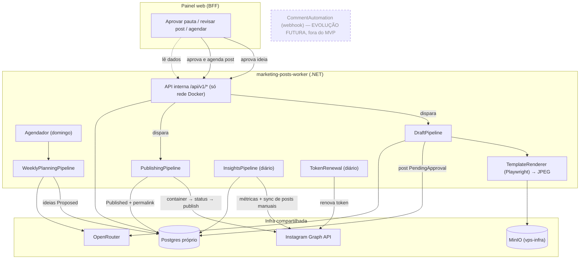
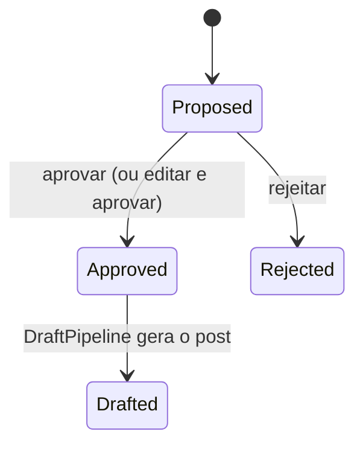
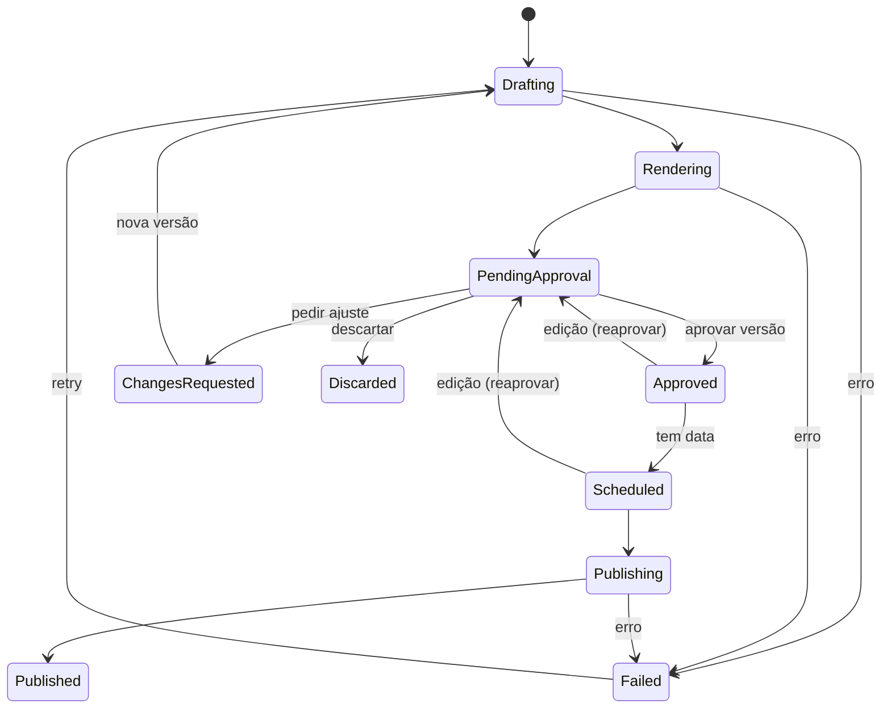

# Worker Marketing Posts — Planejamento e PRD

> Worker .NET que gera, renderiza, agenda e publica o conteúdo do Instagram da Binary Ten **com aprovação humana obrigatória**, reaproveitando a arquitetura do `odd-oddities`.
> Base: `marketing/01-instagram-e-marketing.md` (estratégia, identidade, pilares, ganchos, copy, calendário) e código do `C:\binaryten-git\odd-oddities` (out/2026).
> Documentos irmãos: `docs/worker-captacao.md` e `docs/web-panel-marketing.md` (este último tem o roadmap geral e a topologia da VPS).
> Formato compatível com `/implement-all-prd`: copiar este arquivo para `docs/prd.md` do novo repositório.

---

## 1. Objetivo e escopo

### Objetivo
Transformar o fluxo de conteúdo descrito em `01-instagram-e-marketing.md` em um sistema: o worker propõe pautas, gera rascunhos de **carrossel** (slides renderizados com a identidade da marca + legenda), **para em `PendingApproval`**, e só publica o que foi aprovado no painel web, no horário do calendário.

No MVP o único formato é o **carrossel**. Reels e Stories ficam de fora (ver "Fora do escopo"); geração de Reel curto por IA é uma evolução opcional e desligável (RF-15, custos na §14).

Meta de esforço do Matheus: ~30 min/semana (aprovar pautas e revisar carrosséis).

### Dentro do escopo
- Planejamento semanal de pautas de carrossel, com pilares ponderados, banco de ganchos e anti-repetição.
- Geração de carrossel: slides em JSON → renderização por template HTML (Playwright) → JPEG 1080×1350.
- Máquina de estados com aprovação humana, versionamento e reprocessamento.
- Publicação agendada via Instagram API (carrossel e imagem única).
- Coleta de insights por post e sincronização de posts publicados manualmente.
- API interna consumida pelo painel.

### Fora do escopo
- **Reels e vídeo gravado** (você optou por não gravar). Geração de Reel curto por IA fica como evolução opcional (RF-15), desligada por padrão.
- Stories (feitos à mão no celular; a API não publica stickers de link/enquete). Os Stories fixos (destaques) são publicados manualmente antes do lançamento.
- Comentário → DM automático via webhook (evolução futura, exige validação com a Meta; **não** faz parte do MVP).
- Notificações (Telegram/e-mail) — não entram agora.
- Edição de vídeo, anúncios pagos.
- Publicação 100% automática sem aprovação — **proibido por regra de negócio**.

---

## 2. Decisões de arquitetura

| Decisão | Escolha | Motivo |
|---|---|---|
| Base de código | **Copiar e adaptar** o `odd-oddities` (não compartilhar biblioteca agora) | Dois consumidores ainda não justificam um pacote NuGet; extrair `BinaryTen.Instagram` se surgir um terceiro |
| Runtime | **.NET 10 (LTS)** | O .NET 8 do odd-oddities sai de suporte em **10/11/2026**. Novo projeto já nasce em LTS (suporte até nov/2028). Migrar o odd-oddities é tarefa separada |
| Arquitetura | Hexagonal, 4 projetos (Domain, Application, Infrastructure, Worker) | Mesmo padrão do odd-oddities, que já funciona em produção |
| Orquestração | Vários pipelines pequenos (planejamento, rascunho, publicação, insights) em vez de um único pipeline linear | O fluxo agora tem pausa humana no meio; cada etapa é disparada por estado |
| Gatilho entre etapas | **Polling por estado no Postgres** (a cada 1 min) + chamada direta da API interna quando o painel muda um estado | Sem fila/broker: volume é de poucas dezenas de itens/semana |
| Renderização dos slides | HTML/CSS + **Microsoft.Playwright** (Chromium headless) → "print" 1080×1350 | **Os slides são páginas HTML com as cores e fontes da marca; o LLM só escreve o texto, não a imagem.** Tipografia perfeita em PT-BR, visual sempre igual, custo zero. Imagem de IA erra texto e muda a cada geração — só serve de fundo abstrato opcional |
| Templates | HTML + CSS em `templates/` no repositório, preenchidos com **Scriban** | Versionados no Git, editáveis sem recompilar a lógica |
| Formato de imagem | **JPEG** (qualidade 90, sRGB) | A Instagram API só aceita JPEG para imagem |
| LLM | OpenRouter com seleção dinâmica e fallback por custo (ADR-008 do odd-oddities) | Já existe e custa ~US$ 0 com modelos `:free` |
| Armazenamento de mídia | MinIO compartilhado (`s3.binaryten.com.br`), buckets `marketing-posts-dev` / `marketing-posts-prod`, URL pré-assinada | A Graph API exige URL pública HTTPS; já existe na VPS |
| Banco | Postgres 16 dedicado no compose do worker | Mesmo modelo do odd-oddities; isolamento entre serviços |
| API do Instagram | **Instagram API com Instagram Login** (`graph.instagram.com`, v26.0) | É o que o adapter do odd-oddities já usa; não exige Página do Facebook |
| Aprovação | Painel web (`docs/web-panel-marketing.md`) | Único canal de aprovação; sem Telegram |
| Notificações | **Nenhuma no MVP** | Decisão do Matheus (out/2026): não mexer com Telegram agora |

### Visão geral

O worker é um pequeno web server (como o odd-oddities já é, com `/health` e `/run`). Ele expõe uma **API interna** que só o painel acessa pela rede Docker — não é pública. O webhook de comentário→DM **não existe no MVP** (fica como evolução, em cinza).



---

## 3. O que reaproveitar do odd-oddities

| Componente do odd-oddities | Uso aqui | Ajuste |
|---|---|---|
| `MetaInstagramPublishingAdapter` | Publicação | Adicionar carrossel (itens + pai), `content_publishing_limit`, insights, listagem de mídia; Reel só com RF-15 |
| `TokenRenewalService` + `TokenEncryptionService` (AES-256-GCM) | Igual | Token novo da conta **@binaryten** (não reaproveitar o token do @oddities.odd) |
| `MinioObjectStorageAdapter` + `PresignedUrlService` | Igual | Bucket novo; prefixos `posts/{postId}/v{version}/` |
| `ModelSelectionService`, `OpenRouterModelCatalogAdapter`, `ModelCostEstimator` | Igual | Teto de custo por execução configurável |
| `OpenRouterTextGenerationAdapter` | Base para os geradores | Novos prompts e parsers JSON (ideias, slides, legenda) |
| `SimilarityCheckService` (SHA-256 + Jaccard 90 dias) | Anti-repetição de pautas e ganchos | Normalização de tokens para PT-BR (acentos, stopwords) |
| `PipelineOrchestrator`, `IPipelineStep`, `StepResult`, `PipelineRunner` (SemaphoreSlim) | Base dos pipelines | Um runner por pipeline; lock por pipeline |
| `ScheduleService` | Base do agendador | Vários jobs com horários próprios; fuso `America/Sao_Paulo` |
| `GenerationAttempt`, `PostAudit`, `SystemSetting` | Auditoria | Mantidos |
| `ApplyMigrationsHostedService`, health checks, Serilog JSON, `SensitiveDataDestructuringPolicy`, `GlobalExceptionMiddleware` | Igual | — |
| `ImageSharpProcessingService` | Conversão/validação de JPEG | Sem marca d'água (a assinatura vem do template) |
| `.github/workflows/deploy.yml` | Deploy | Novos secrets; rede `vps-apps` |
| `CategorySelection`/`SelectBalancedCategoryUseCase` | Vira seleção ponderada de **pilares** | Pesos 35/30/15/10/10 |

Não reaproveitar: `ImageGenerationStep` como peça principal (imagem IA só como fundo opcional), `SourceValidationService` (não há "fonte factual"), conteúdo em inglês.

---

## 4. Modelo de domínio

### 4.1 Estados

**Ideia (pauta)**


**Post**


Aprovação é sempre **por versão**: qualquer edição de um post `Approved`/`Scheduled` o devolve para `PendingApproval`. O formato Reel (RF-15, opcional) usa o mesmo diagrama, com a geração do vídeo entre `Drafting` e `Rendering`.

### 4.2 Entidades (PostgreSQL, código em inglês)

| Entidade | Campos principais |
|---|---|
| `ContentPillar` | id, key (`before_after`, `education`, `proof_backstage`, `offer`, `opinion`), name, weight, description_for_prompt, active |
| `Hook` | id, text, pattern (erro+consequência, número, contraste, curiosidade, nicho), pillar_id?, times_used, last_used_at, avg_share_rate (alimentado por insights), active |
| `CalendarSlot` | id, day_of_week, local_time, format (`Carousel` no MVP; `Image` opcional), pillar_strategy (fixo ou alternado), active — seed MVP: 3 carrosséis/semana (SEG/QUA/SEX) com pilares alternados |
| `WeeklyPlan` | id, week_start (segunda), status (Generating/Ready/Completed), insights_digest (jsonb), created_at |
| `Idea` | id, weekly_plan_id, calendar_slot_id, pillar_id, format, title, angle, hook_text, target_niche?, cta_type (share/save/direct), lead_ref? (caso "Refazendo o site de…"), status, content_hash, rejection_reason?, created_at |
| `Post` | id, idea_id?, format, status, version, caption, hashtags (text[]), cta_type, scheduled_at?, approved_at?, approved_version?, meta_container_id?, meta_media_id?, permalink?, published_at?, failure_step?, failure_reason?, error_code?, origin (Pipeline/ManualSync), created_at, updated_at — campos de vídeo (`video_object_key`, `cover_object_key`) só entram com a RF-15 (Reel por IA) |
| `PostSlide` | id, post_id, version, index, template (Cover/Content/BeforeAfter/Proof/Cta), payload (jsonb), object_key, width, height, bytes |
| `PostRevision` | id, post_id, version, changed_by (system/user), change_type, diff (jsonb), created_at — trilha de aprovação |
| `PostInsight` | id, post_id, collected_at, reach, views, likes, comments, saved, shares, profile_visits, follows, total_interactions |
| `GenerationAttempt`, `PostAudit`, `SystemSetting` | como no odd-oddities |

Seeds via migration: 5 pilares com pesos, os 20 ganchos de `01-instagram-e-marketing.md` §7, 3 slots de carrossel no calendário.

---

## 5. Pipelines e agendamentos

Todos os horários em `America/Sao_Paulo`. Cada job tem lock próprio (`SemaphoreSlim`) e pode ser disparado manualmente por endpoint (`POST /run/{job}`), como o `/run` atual.

### 5.1 WeeklyPlanningPipeline — domingo 08:00
1. `InsightsDigestStep`: resume os posts das últimas 4 semanas (top 3 por envios/alcance e por salvamentos/alcance, piores 2, ganchos vencedores).
2. `PillarSelectionStep`: escolhe pilar de cada slot (fixo ou ponderado), garantindo 1 post de Oferta por mês (primeira semana do mês).
3. `IdeaGenerationStep`: LLM devolve JSON com N ideias (padrão 3, uma por slot + 2 reservas), cada uma com título, ângulo, gancho principal, gancho alternativo, CTA e nicho-alvo.
4. `IdeaSimilarityStep`: rejeita ideias com Jaccard ≥ 0,6 contra ideias/posts dos últimos 90 dias e ganchos usados nos últimos 30 dias; re-tenta até 3 vezes.
5. Persiste como `Proposed`. O painel mostra "3 pautas aguardando aprovação" (sem notificação externa no MVP).

### 5.2 DraftPipeline — polling a cada 1 min (ou disparo imediato pela API)
Para cada `Idea` aprovada sem post, ou post em `ChangesRequested`:

**Carrossel** (único formato do MVP)
1. `SlidesGenerationStep`: LLM devolve JSON validado por schema:
   ```json
   {
     "slides": [
       { "template": "cover", "title": "Seu site espanta cliente", "highlight": "3 segundos", "body": null },
       { "template": "content", "title": "Demora para abrir", "body": "Metade das pessoas desiste em 3 segundos no celular.", "icon": "clock" },
       { "template": "before_after", "before": "Sem botão de WhatsApp", "after": "Contato em 1 toque" },
       { "template": "cta", "title": "Comenta SITE", "body": "Te mando o diagnóstico grátis do seu site." }
     ]
   }
   ```
2. `SlidesValidationStep` (regras de `01` §4 e §5): 5–8 slides; 1º = `cover`, último = `cta`; título ≤ 7 palavras; corpo ≤ 180 caracteres; no máx. 1 destaque laranja por slide; lista de termos proibidos (`SPA`, `SEO on-page`, `deploy`, `stack`, `framework`…). Falha → nova tentativa com o erro no prompt (máx. 3) e fallback de modelo.
3. `TemplateRenderingStep`: renderiza cada slide (ver §6) → JPEG → MinIO.
4. `CaptionGenerationStep`: legenda PAS + CTA (`01` §8), 1ª linha < 125 caracteres, 3–5 hashtags, 2–4 palavras-chave locais; total ≤ 2.200 caracteres.
5. Estado `PendingApproval`, versão +1, `PostRevision`.

**Imagem única** (uso raro, ex.: anúncio de vagas do mês): 1 slide `cover` ou `proof` + legenda.

### 5.3 PublishingPipeline — polling a cada 1 min
1. `Approved` com `scheduled_at` → `Scheduled`. Sem data → próximo slot livre do calendário compatível com o formato.
2. Em `scheduled_at` ≤ agora: confere `approved_version == version`; consulta `content_publishing_limit`; gera URLs pré-assinadas (TTL 2 h).
3. Cria containers:
   - Carrossel (padrão): um container por slide com `is_carousel_item=true` → container pai `media_type=CAROUSEL`, `children=<ids>`, `caption`.
   - Imagem única: `POST /{ig-user-id}/media` com `image_url`, `caption`.
   - Reel (só se RF-15 ativa): `media_type=REELS`, `video_url`, `cover_url`, `share_to_feed=true`, `caption`.
4. Polling do `status_code` do container até `FINISHED` (timeout 10 min para vídeo) → `media_publish` → busca `permalink`.
5. **Idempotência**: salvar `meta_container_id` antes do `media_publish`. Ao retomar um post em `Publishing`, consultar o status do container; se `PUBLISHED`, recuperar o media id em `/{ig-user-id}/media` (casando timestamp/legenda) em vez de publicar de novo. Nunca re-tentar `media_publish` às cegas.
6. Post atrasado mais de 2 h (ex.: worker parado) **não publica sozinho**: volta para `Approved` sem data (o painel mostra isso em `GET /status`).

### 5.4 InsightsPipeline — diário 06:00
- Para posts publicados há ≤ 30 dias: `GET /{media-id}/insights` com `reach, views, likes, comments, saved, shares, total_interactions` (+ `profile_visits`, `follows` quando disponíveis). Métricas mudam entre versões da API — tratar métrica não suportada como ausente, sem quebrar o job.
- **Sync de mídia**: `GET /{ig-user-id}/media` cria `Post` com `origin=ManualSync` para o que foi publicado direto pelo app (Stories/posts manuais), para que o painel e o digest semanal enxerguem 100% do perfil.
- Atualiza `Hook.avg_share_rate`.

### 5.5 TokenRenewal — diário 03:00
Igual ao odd-oddities (renova quando faltam < N dias; persiste criptografado).

### 5.6 CommentAutomation — webhook (EVOLUÇÃO FUTURA, fora do MVP — RF-13)
Fica aqui só como referência de projeto; **não é implementado no MVP** e depende de validação com a Meta (modo Live, App Review, possível verificação de empresa com CNPJ).
1. `GET /webhooks/instagram`: verificação `hub.mode`/`hub.verify_token`/`hub.challenge`.
2. `POST /webhooks/instagram`: valida `X-Hub-Signature-256` (HMAC-SHA256 com o App Secret); responde 200 imediatamente; enfileira em tabela.
3. Processador: ignora comentários da própria conta; normaliza texto; casa com `CommentTrigger`; deduplica por `comment_id`.
4. Resposta pública (`POST /{comment-id}/replies`) com variações de texto.
5. DM privada (`POST /{ig-user-id}/messages` com `recipient.comment_id`).
6. Se `create_lead`: `POST` na API interna do worker-captacao (`source=InstagramComment`).

---

## 6. Renderização de templates

- Canvas 1080×1350 (feed 4:5).
- Estrutura:
  ```
  templates/
    shared/brand.css        # paleta, tipografia, grid 60px, trilhas de circuito (opacidade 10–15%)
    shared/fonts/           # Space Grotesk, Plus Jakarta Sans (woff2, licença OFL) — sem depender de Google Fonts em runtime
    shared/assets/          # logo, molduras de navegador/celular, ícones (check ciano, círculo laranja)
    carousel/cover.html
    carousel/content.html
    carousel/before_after.html
    carousel/proof.html
    carousel/cta.html
    reel/cover.html         # só quando a RF-15 (Reel por IA) estiver ativa
  ```
- Paleta e regras de `01` §4: fundo `#080B12`, cards `#161E2D`, ciano `#26B2F2`, celeste `#42DBF0`, laranja `#FF7A1A` (extrair o tom exato da logo), texto `#F5F8FC`/`#AEB6C4`. Laranja = problema/CTA, no máximo 1 por peça; glow em 1 elemento por slide; corpo ≥ 28 px.
- Último slide sempre com assinatura: logo + `binaryten.com.br` + "Matheus • Binary Ten".
- Processo: Scriban gera HTML → `page.SetContentAsync` → `await document.fonts.ready` → screenshot `jpeg` qualidade 90 → validação ImageSharp (dimensão, peso < 8 MB) → MinIO.
- Um único browser por execução de pipeline, fechado ao final (Chromium usa 200–400 MB enquanto ativo).
- Escape de HTML em todo campo vindo do LLM (Scriban `html.escape`) — evita quebra de layout e injeção.
- Imagem de IA (opcional, ~US$ 0,01): só como fundo abstrato de `cover`, nunca como peça principal (`01` §2).

Testes de regressão visual: snapshot dos 5 templates de carrossel com payload fixo; comparar hash/perceptual diff no CI local.

---

## 7. Prompts

- Arquivos versionados em `prompts/` (`weekly_ideas.md`, `carousel_slides.md`, `caption.md`), carregados na inicialização.
- Bloco comum de **voz da marca** (`01` §5): direta, didática, levemente provocativa, fala com o dono do negócio, sempre concreta, sem tecniquês; arquétipos Mago + Sábio + Cara Comum; proibido Herói exagerado e meme de programador.
- Contexto injetado: pilar e descrição, slot/formato, ganchos disponíveis, digest de insights, ideias recentes (para evitar repetição), nicho-alvo, CTA.
- Saída sempre em JSON com schema explícito; parser tolerante a cercas de código (como o `CuriosityJsonParser`).
- Conteúdo publicado em **português**; código e logs em inglês (convenção do odd-oddities).

---

## 8. API interna (consumida pelo painel)

Base `http://marketing-posts-worker:8080/api/v1`, acessível **só na rede Docker `vps-apps`**. Header obrigatório `X-Internal-Api-Key` (comparação em tempo constante). Erros em `application/problem+json`.

| Método | Rota | Uso |
|---|---|---|
| GET | `/ideas?status=&week=` | Pautas da semana |
| POST | `/ideas/{id}/approve` | Aprovar (aceita edição de título/ângulo/gancho no corpo) |
| POST | `/ideas/{id}/reject` | Rejeitar com motivo |
| POST | `/ideas` | Criar pauta manual (inclusive a partir de um lead: "Refazendo o site de…") |
| POST | `/plans/generate` | Gerar pautas agora (geração sob demanda) |
| POST | `/posts` | **Criar post do zero**: `{ pillar?, slideCount?, suggestedText?, imageHints?, caption? }` → dispara o DraftPipeline na hora |
| GET | `/posts?status=&from=&to=&format=` | Lista e calendário |
| GET | `/posts/{id}` | Detalhe com slides (URLs pré-assinadas, TTL 15 min), legenda, revisões |
| PUT | `/posts/{id}/slides` | Editar payload dos slides → re-render (nova versão) |
| PUT | `/posts/{id}/caption` | Editar legenda/hashtags |
| POST | `/posts/{id}/regenerate` | `ChangesRequested` com instrução livre ("mais curto", "trocar gancho") |
| POST | `/posts/{id}/approve` | Aprovar a versão atual (`{ version, scheduledAt? }`) |
| POST | `/posts/{id}/schedule` | Alterar data |
| POST | `/posts/{id}/publish-now` | Publicar imediatamente |
| POST | `/posts/{id}/discard` | Descartar |
| POST | `/posts/{id}/retry` | Reprocessar `Failed` |
| GET | `/posts/{id}/insights` | Série de métricas |
| GET | `/insights/summary?weeks=` | Resumo para dashboard |
| GET/PUT | `/settings/calendar`, `/settings/pillars`, `/settings/hooks` | Configuração |
| GET | `/status` | Saúde dos jobs: última execução, próxima, falhas, validade do token, cota de publicação, posts atrasados |

Rotas de Reel por IA (`/posts/{id}/video`, `/posts/{id}/cover`), comentários (`/comments`, `/settings/comment-triggers`) e `mark-published` só entram com as RFs 13/15.

Contratos OpenAPI gerados (`Microsoft.AspNetCore.OpenApi`) e versionados em `docs/openapi.json` para o painel gerar o client TypeScript.

---

## 9. Configuração

Mesmo esquema de camadas do odd-oddities (appsettings → User Secrets → variáveis de ambiente). `.env.example`:

```env
# Banco
POSTGRES_DB=marketing_posts
POSTGRES_USER=marketing_posts
POSTGRES_PASSWORD=

# OpenRouter
OPENROUTER_API_KEY=
TEXT_MODEL_ID=google/gemma-4-26b-a4b-it:free
IMAGE_MODEL_ID=                      # vazio = não usa imagem IA
MAX_COST_PER_RUN_USD=0.05

# Meta / Instagram (conta @binaryten)
META_APP_ID=
META_APP_SECRET=
META_ACCESS_TOKEN=
INSTAGRAM_USER_ID=

# MinIO (compartilhado)
STORAGE_DOMAIN=s3.binaryten.com.br
MINIO_ACCESS_KEY=
MINIO_SECRET_KEY=
MINIO_BUCKET_NAME=marketing-posts-prod

# Segurança
TOKEN_ENCRYPTION_KEY=                # 32 caracteres
INTERNAL_API_KEY=                    # compartilhada com o painel

# Agenda
SCHEDULE_TIMEZONE=America/Sao_Paulo
PLANNING_CRON=SUN 08:00
PUBLISH_DEFAULT_TIME=12:00           # ajustar com base nos insights

# Integração com o worker-captacao (só RF-12: pauta a partir de lead)
CAPTACAO_API_BASE_URL=http://captacao-worker:8080/api/v1
CAPTACAO_API_KEY=

# Reel por IA (RF-15, opcional)
ENABLE_AI_REELS=false
VIDEO_MODEL_ID=                      # ex.: google/veo-3.1-lite
MAX_VIDEO_COST_PER_MONTH_USD=5

# Comentário→DM (RF-13, opcional)
META_WEBHOOK_VERIFY_TOKEN=
```

---

## 10. Deploy na VPS (mesmo modelo do odd-oddities)

- Repositório: `binaryten-marketing-posts` (GitHub, branch `main`).
- `docker-compose.yml`: serviços `marketing-posts-worker` e `marketing-posts-postgres`.
  - Postgres só na rede interna `marketing-posts-internal`.
  - Worker nas redes `marketing-posts-internal` **e** `vps-apps` (externa), para o painel e o Nginx alcançarem.
  - `mem_limit` sugerido: worker 1 GB (pico do Chromium), Postgres 256 MB.
  - Healthcheck `curl /health`, logs `json-file` 10 MB × 3.
- `Dockerfile`: multi-stage SDK 10 → runtime com Chromium e dependências do Playwright. Duas opções (decidir na RF-01):
  1. Base `mcr.microsoft.com/playwright/dotnet` na versão do pacote `Microsoft.Playwright` (verificar se a tag já traz .NET 10).
  2. Base `aspnet:10.0` + `pwsh playwright.ps1 install --with-deps chromium` copiado do estágio de build.
  Fixar a versão do `Microsoft.Playwright`; browser e pacote precisam bater.
- Fontes da marca embarcadas no repositório (`templates/shared/fonts`), não instaladas no SO.
- GitHub Actions `deploy.yml` com `workflow_dispatch` (SSH → `git pull` → escreve `.env` a partir de Secrets/Variables → `docker compose up -d --build`), copiado do odd-oddities.
- MinIO (`vps-infra`): criar buckets `marketing-posts-dev`/`-prod`, policy e access key próprias (`docs/bucket-management.md`).
- Nginx: **não há domínio próprio**. O webhook da Fase 3 entra pelo vhost do painel (`painel.binaryten.com.br/webhooks/instagram` → `marketing-posts-worker:8080`), configurado em `web-panel-marketing.md`.
- Backup: cron diário no host com `pg_dump` → gzip → bucket `backups` do MinIO, retenção 14 dias. Recomendado copiar semanalmente para fora da VPS (ex.: Backblaze B2 free tier ou Google Drive) — backup na mesma máquina não protege contra perda da VPS.

---

## 11. Segurança

- API interna sem exposição pública; chave obrigatória mesmo dentro da rede Docker.
- Token Meta criptografado em repouso (AES-256-GCM), nunca logado (`SensitiveDataDestructuringPolicy`).
- URLs pré-assinadas com TTL curto (painel 15 min, Meta 2 h); bucket privado.
- Conteúdo do LLM sempre escapado nos templates.
- Container como usuário não root (igual ao odd-oddities).
- Só nas RFs opcionais: webhook (RF-13) valida assinatura HMAC antes de processar e rejeita payload > 1 MB; vídeo gerado por IA (RF-15) tem nome de objeto gerado pelo servidor.

---

## 12. Observabilidade

- Logs Serilog JSON com `ExecutionId`, `PostId`, `IdeaId`, `Pipeline`, `Step`.
- `GET /status` para o painel (jobs, falhas, token, cota) — é como o painel sabe o que aconteceu, no lugar de notificação push.
- Sem notificações externas no MVP. Se a stack do `coolify-infra/observability` (Loki/Promtail/Grafana) for ao ar, os logs JSON já entram sem mudança.

---

## 13. Testes

- xUnit + NSubstitute + **FluentAssertions 6.x/7.x** (a v8 exige licença comercial; manter a linha 6.12 do odd-oddities ou trocar por AwesomeAssertions/Shouldly).
- Unitários: máquina de estados, validação de slides, parsers JSON, seleção de pilar, similaridade PT-BR, montagem do container de carrossel, idempotência da publicação.
- Integração: Testcontainers (Postgres) para repositórios e migrations; renderização dos templates com Playwright real (smoke).
- Sem chamadas reais à Meta/OpenRouter nos testes; adapters com `HttpMessageHandler` fake.

---

## 14. Custos

| Item | Custo (MVP, só carrossel) |
|---|---|
| Texto (OpenRouter `:free` ou Flash barato) | ~US$ 0 |
| Imagem IA opcional (fundo abstrato) | ~US$ 0,01/imagem |
| Renderização, Postgres, MinIO | US$ 0 (VPS existente) |
| Instagram API | US$ 0 |
| **Total estimado (MVP)** | **< US$ 1/mês** |
| Reel curto por IA (opcional, RF-15) | ~US$ 0,30–0,80 por Reel de 8s (Veo 3.1 Lite ~US$ 0,04/s sem áudio); 1–2/semana ≈ **US$ 2–6/mês** |

---

## 15. Riscos e pontos a validar

| Risco | Mitigação |
|---|---|
| Métricas de insights renomeadas/depreciadas entre versões | Tratar métrica ausente como nula; versão da API em constante única |
| Chromium aumenta imagem (~1 GB) e RAM em pico | Browser só durante renderização; `mem_limit`; VPS Contabo (8 GB) folgada para isso |
| Posts genéricos de IA prejudicam a marca | Aprovação obrigatória, validações de voz; carrossel sempre com template da marca |
| Publicação dupla em falha de rede | Idempotência por container (§5.3) |
| Token expira | Renovação diária |
| **Reel por IA (RF-15)**: custo deixa de ser zero; Veo embute SynthID e o Instagram aplica selo "Informações de IA"; vídeo de 8s sem roteiro raramente vende serviço local | Feature **opcional e desligada por padrão**; teto de custo mensal configurável; usar só como motion de apoio (fundo/texto), nunca como peça de prova social |
| Comentário→DM (evolução futura) pode exigir app Live + App Review + verificação de empresa (CNPJ, `05`) | Fora do MVP; quando for feito, spike antes com conta não tester; ManyChat free como plano B |

---

## 16. Requisitos funcionais

Fases do roadmap geral (`web-panel-marketing.md` §2): **Fase 1 — Conteúdo no ar** RF-01 a RF-10 · **Fase 3 — Otimização** RF-11 a RF-15.

## [ ] RF-01: Estrutura da solução e walking skeleton

- Criar solução `BinaryTen.MarketingPosts` (.NET 10) com projetos Domain, Application, Infrastructure, Worker e UnitTests, copiando a base do odd-oddities (Serilog, health check `/health`, `GlobalExceptionMiddleware`, `ApplyMigrationsHostedService`, `AppConfiguration`, `IClock`).
- `AGENTS.md` com comandos de build/test/format, como no odd-oddities.
- `docker-compose.yml`, `docker-compose.dev.yml` (Postgres local), `Dockerfile` com Chromium funcional, `.env.example`, `.gitignore`, `.dockerignore`.
- Critérios de aceite: `dotnet build` e `dotnet test` passam; `docker compose up` sobe worker e Postgres; `/health` retorna 200; um teste de fumaça abre o Chromium dentro do container e gera um PNG.

**Dependências:** nenhuma

## [ ] RF-02: Pipeline de deploy e backup

- `.github/workflows/deploy.yml` (workflow_dispatch) baseado no do odd-oddities, com os novos Secrets/Variables.
- Compose conectado à rede externa `vps-apps`; Postgres apenas na rede interna.
- Script `scripts/backup.sh` (pg_dump → gzip → `mc cp` para o bucket `backups`, retenção 14 dias) e instrução de cron no README.
- Critérios de aceite: deploy manual pelo GitHub Actions sobe o container na VPS; backup gerado e restaurado com sucesso em ambiente local.

**Dependências:** RF-01

## [ ] RF-03: Modelo de dados e seeds

- Entidades e configurações EF Core da §4.2 (sem campos de vídeo/comentário no MVP), migrations auto-aplicadas.
- Seeds: 5 pilares com pesos, 20 ganchos, 3 slots de carrossel.
- Enums de estado com transições válidas centralizadas em uma máquina de estados de domínio (método `CanTransitionTo` + testes).
- Critérios de aceite: migração cria o schema do zero; testes cobrem todas as transições válidas e inválidas da §4.1.

**Dependências:** RF-01

## [ ] RF-04: Integrações reaproveitadas (Meta, MinIO, OpenRouter)

- Portar `MetaInstagramPublishingAdapter`, `TokenRenewalService`, `TokenEncryptionService`, `MinioObjectStorageAdapter`, `PresignedUrlService`, `ModelSelectionService` e adapters do OpenRouter.
- Estender a porta de publicação com: container de item de carrossel, container de carrossel (`media_type=CAROUSEL`, `children`), `content_publishing_limit`, listagem de mídia.
- Job `TokenRenewal` diário.
- Critérios de aceite: testes com `HttpMessageHandler` fake para cada chamada nova; token salvo criptografado; nenhum segredo nos logs.

**Dependências:** RF-03 · Externas: Meta Graph API, MinIO, OpenRouter

## [ ] RF-05: API interna base

- Minimal API em `/api/v1` com autenticação por `X-Internal-Api-Key` (tempo constante), ProblemDetails, OpenAPI exportado para `docs/openapi.json`.
- Endpoints de leitura/escrita de ideias e posts da §8 (as ações que dependem de RFs futuras retornam 409 com mensagem clara até serem implementadas).
- `GET /status` com última/próxima execução de cada job.
- Endpoints `POST /run/{job}` para disparo manual.
- Critérios de aceite: requisição sem chave → 401; contratos documentados; testes de integração com `WebApplicationFactory`.

**Dependências:** RF-03

## [ ] RF-06: Planejamento semanal de pautas

- `WeeklyPlanningPipeline` conforme §5.1 (digest de insights vazio enquanto não houver dados).
- Seleção ponderada de pilares, Oferta 1×/mês, anti-repetição (Jaccard ≥ 0,6 em 90 dias; ganchos em 30 dias) com normalização PT-BR.
- Prompts em `prompts/weekly_ideas.md` com a voz da marca.
- Agendado para domingo 08:00 `America/Sao_Paulo`; também via `POST /plans/generate` (geração sob demanda pelo painel).
- Critérios de aceite: gera ideias `Proposed` válidas para cada slot ativo; ideia similar é rejeitada e regenerada; custo por execução respeita `MAX_COST_PER_RUN_USD`.

**Dependências:** RF-04, RF-05

## [ ] RF-07: Geração de carrossel e legenda

- `SlidesGenerationStep`, `SlidesValidationStep` e `CaptionGenerationStep` conforme §5.2 e §7.
- Regras de validação: 5–8 slides, cover primeiro e CTA por último, título ≤ 7 palavras, corpo ≤ 180 caracteres, termos proibidos, legenda ≤ 2.200 caracteres, 3–5 hashtags, 1ª linha < 125 caracteres.
- Reprocessamento com o erro de validação no prompt (máx. 3) e fallback de modelo.
- Suporta tanto ideia aprovada do planejamento quanto **post criado do zero** pelo painel (ver RF-09).
- Critérios de aceite: ideia aprovada gera post com slides válidos e legenda; violações de regra são testadas uma a uma.

**Dependências:** RF-06

## [ ] RF-08: Renderização de templates da marca

- Templates HTML/CSS da §6 (cover, content, before_after, proof, cta) com paleta, fontes embarcadas e assinatura.
- Renderização com Playwright → JPEG 1080×1350, validação com ImageSharp, upload em `posts/{postId}/v{version}/{index}.jpg`.
- Escape de todos os campos dinâmicos; fundo abstrato de IA opcional por slide (desligado por padrão).
- Critérios de aceite: os 5 templates renderizam com payload fixo idêntico ao snapshot aprovado; texto longo não vaza do canvas (teste com payload no limite); post passa a `PendingApproval` com slides no MinIO.

**Dependências:** RF-07 · Externas: Playwright/Chromium

## [ ] RF-09: Aprovação, edição, versionamento e criação do zero

- Ações da API: aprovar/rejeitar ideia (com edição), **criar post do zero** (`POST /posts` com texto sugerido, nº de slides, dicas de imagem; dispara o DraftPipeline na hora), editar slides (re-render), editar legenda, pedir regeneração com instrução livre, aprovar versão, agendar, descartar.
- Toda edição incrementa `version`, grava `PostRevision` e invalida aprovação anterior.
- Aprovar exige `version` igual à atual (evita aprovar o que não foi visto).
- Critérios de aceite: não existe caminho que publique post sem aprovação da versão atual (teste dedicado); criar do zero gera rascunho renderizado; histórico de revisões completo.

**Dependências:** RF-08

## [ ] RF-10: Publicação agendada (carrossel e imagem)

- `PublishingPipeline` conforme §5.3: agendamento por data ou próximo slot, verificação de cota, containers, polling de status, `media_publish`, permalink.
- Idempotência por `meta_container_id`; post atrasado > 2 h não publica sozinho.
- `publish-now` e `retry`.
- Critérios de aceite: carrossel de teste publicado na conta real em horário agendado; queda simulada entre container e publish não gera post duplicado; falha da API leva a `Failed` com `error_code`.

**Dependências:** RF-09

## [ ] RF-11: Insights e sincronização de mídia

- `InsightsPipeline` diário (§5.4), tolerante a métricas indisponíveis.
- Sync de mídias publicadas manualmente (`origin=ManualSync`) — inclui os Stories/posts que você postar pelo app.
- Endpoints `/posts/{id}/insights` e `/insights/summary`.
- Digest real alimentando o planejamento semanal; atualização de `Hook.avg_share_rate`.
- Critérios de aceite: métricas gravadas para posts dos últimos 30 dias; post publicado pelo app aparece no sistema em até 24 h.

**Dependências:** RF-10

## [ ] RF-12: Pauta a partir de lead ("Refazendo o site de…")

- `POST /ideas` aceitando `lead_ref` e contexto (nicho, problemas do diagnóstico), com instrução para **anonimizar** nome e marca do negócio, salvo autorização marcada.
- Pilar `before_after` por padrão.
- Critérios de aceite: ideia criada a partir do painel com dados do lead; texto gerado não contém o nome do negócio quando `authorized=false`.

**Dependências:** RF-06 · Externas: worker-captacao (dados do lead vêm pelo painel)

## [ ] RF-13: Comentário com palavra-chave → resposta + DM + lead (opcional)

- Spike obrigatório antes: confirmar se o app recebe webhooks de comentários de usuários não testers no modo atual; registrar resultado neste documento. Se bloquear, manter desligado e usar ManyChat.
- Endpoints `GET/POST /webhooks/instagram` com verificação e HMAC; inscrição dos campos `comments` e `messages`; entidades `CommentTrigger`/`CommentInteraction` (migration própria).
- Processamento assíncrono, deduplicação por `comment_id`, resposta pública com variação, DM privada, criação de lead no worker-captacao.
- Critérios de aceite: comentário "site" em post de teste gera resposta pública, DM e lead com `source=InstagramComment`; webhook com assinatura inválida → 401 sem processar; feature desligável por configuração.

**Dependências:** RF-05 · Externas: Meta Webhooks, API interna do worker-captacao

## [ ] RF-14: Desligar/alternar fundo de imagem por IA no carrossel

- Permitir que `cover` use um fundo abstrato gerado por IA (OpenRouter image), com cache por hash do prompt e teto de custo.
- Critérios de aceite: ligado por configuração, o cover usa o fundo de IA; desligado (padrão), usa o fundo do template; custo registrado.

**Dependências:** RF-08 · Externas: OpenRouter (imagem)

## [ ] RF-15: Reel curto gerado por IA (opcional, desligado por padrão)

- Para posts marcados como `Reel`: `ReelAiPipeline` gera um vídeo vertical 9:16 de 6–10 s via OpenRouter (`POST /api/v1/videos`, ex.: Veo 3.1 Lite sem áudio), com teto de custo mensal (`MAX_VIDEO_COST_PER_MONTH_USD`), aprovação humana, capa renderizada pelo template, publicação com `media_type=REELS`.
- Campos de vídeo entram no `Post` nesta RF; feature **desligada por padrão** (`ENABLE_AI_REELS=false`).
- Critérios de aceite: com a flag ligada e dentro do teto, um Reel de teste é gerado, aprovado e publicado na conta real; estourar o teto bloqueia a geração com mensagem clara; com a flag desligada, o sistema ignora o formato Reel.

**Dependências:** RF-10, RF-11 · Externas: OpenRouter (vídeo), Meta Graph API

**Dependências:** RF-06 · Externas: worker-captacao (dados do lead vêm pelo painel)

## [ ] RF-15: Comentário com palavra-chave → resposta + DM + lead

- Spike obrigatório antes: confirmar se o app recebe webhooks de comentários de usuários não testers no modo atual; registrar resultado neste documento.
- Endpoints `GET/POST /webhooks/instagram` com verificação e HMAC (§5.6); inscrição dos campos `comments` e `messages`.
- Processamento assíncrono, deduplicação por `comment_id`, resposta pública com variação, DM privada, criação de lead no worker-captacao.
- Critérios de aceite: comentário "site" em post de teste gera resposta pública, DM e lead com `source=InstagramComment`; webhook com assinatura inválida → 401 sem processar.

**Dependências:** RF-05, RF-11 · Externas: Meta Webhooks, API interna do worker-captacao

## [ ] RF-16: Trial Reels com gancho alternativo

- Para Reels com `alternative_hook` e flag `is_trial_reel`, publicar como Trial Reel (parâmetros confirmados na doc da Meta na data da implementação).
- Registrar qual gancho venceu e alimentar `Hook`.
- Critérios de aceite: Trial Reel publicado em conta real; feature desligável por configuração.

**Dependências:** RF-12, RF-13
